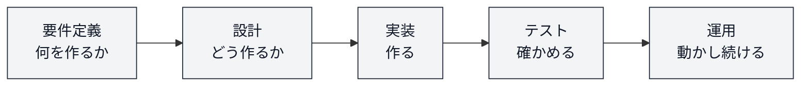
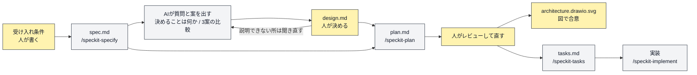

# ソリューショニングとプロトタイピング

講義スライドは後日公開します。／ [講師向けメモ](./facilitator-notes.md)

## 目次

- [3限目: 設計 — ひとりで、設計からプロトタイプまで](#3限目-設計--ひとりで設計からプロトタイプまで)
  - [1. イントロダクションと準備 (14分)](#1-イントロダクションと準備-14分)
    - [1.1 この演習の全体像（7回）](#11-この演習の全体像7回)
    - [1.2 前回までの振り返り](#12-前回までの振り返り)
    - [1.3 今日のゴール](#13-今日のゴール)
    - [1.4 今日の作業フォルダを作る](#14-今日の作業フォルダを作る)
    - [1.5 Spec Kit の入ったフォルダをダウンロードする](#15-spec-kit-の入ったフォルダをダウンロードする)
    - [1.6 Antigravity IDE で開く](#16-antigravity-ide-で開く)
    - [1.7 図を描く拡張機能を入れる](#17-図を描く拡張機能を入れる)
    - [1.8 準備チェック](#18-準備チェック)
  - [2. いま、開発プロセスのどこにいるか (3分)](#2-いま開発プロセスのどこにいるか-3分)
  - [3. 要件定義: 何を作るかを決める (9分)](#3-要件定義-何を作るかを決める-9分)
  - [4. 演習D-1: まず、作ってみよう (10分)](#4-演習d-1-まず作ってみよう-10分)
  - [5. お客さんから、追加の要望が来ました (7分)](#5-お客さんから追加の要望が来ました-7分)
  - [6. 考えてみよう: なぜ、説明できなかったのか? (7分)](#6-考えてみよう-なぜ説明できなかったのか-7分)
  - [7. 設計とは何か (9分)](#7-設計とは何か-9分)
  - [8. 一番効くのは「つなぎ目」を先に決めること (8分)](#8-一番効くのはつなぎ目を先に決めること-8分)
  - [9. AIと一緒に設計する (11分)](#9-aiと一緒に設計する-11分)
  - [10. 演習D-2: 設計してから、作り直そう (20分)](#10-演習d-2-設計してから作り直そう-20分)
  - [11. 3限目まとめ (2分)](#11-3限目まとめ-2分)
- [4限目: プロトタイピング — チームで、設計から公開まで](#4限目-プロトタイピング--チームで設計から公開まで)
  - [12. チームになって、持ち寄る (7分)](#12-チームになって持ち寄る-7分)
  - [13. 演習F-1: チームで1つの設計に決める (18分)](#13-演習f-1-チームで1つの設計に決める-18分)
  - [14. 演習F-2: 分担して開発し、途中で一度集める (20分)](#14-演習f-2-分担して開発し途中で一度集める-20分)
  - [15. 演習F-3: 統合して、動かす (12分)](#15-演習f-3-統合して動かす-12分)
  - [16. チーム開発は、なぜ難しいのか (13分)](#16-チーム開発はなぜ難しいのか-13分)
  - [17. アーキテクチャスタイルと技術選択 (9分)](#17-アーキテクチャスタイルと技術選択-9分)
  - [18. 検査してから、公開する（講師デモ） (13分)](#18-検査してから公開する講師デモ-13分)
  - [19. まとめ・提出物・次回予告 (8分)](#19-まとめ提出物次回予告-8分)
- [課題と評価](#課題と評価)
- [参考](#参考)

---

# 3限目: 設計 — ひとりで、設計からプロトタイプまで

| # | 内容 | 時間 | 形式 |
| --- | --- | --- | --- |
| 1 | イントロダクションと準備 | 14分 | 講義＋各自 |
| 2 | いま、開発プロセスのどこにいるか | 3分 | 講義 |
| 3 | 要件定義: 何を作るかを決める | 9分 | 講義 |
| 4 | **演習D-1**: まず、作ってみよう | 10分 | 個人 |
| 5 | お客さんから、追加の要望が来ました | 7分 | 個人 |
| 6 | **考えてみよう**: なぜ、説明できなかったのか? | 7分 | Slackスレッド＋全体 |
| 7 | 設計とは何か | 9分 | 講義 |
| 8 | 一番効くのは「つなぎ目」を先に決めること | 8分 | 講義 |
| 9 | AIと一緒に設計する | 11分 | 講義＋実演 |
| 10 | **演習D-2**: 設計してから、作り直そう | 20分 | 個人 |
| 11 | 3限目まとめ | 2分 | 講義 |
| | **合計** | **100分** | |

## 1. イントロダクションと準備 (14分)

### 1.1 この演習の全体像（7回）

本演習は全7回（1回あたり2コマ・各100分）です。シラバス上は全14回ですが、内容の近い2回分をまとめて1日で実施します。**今日は第4回**です。

| 回数 | 1 | 2 | 3 | **4** | 5 | 6 | 7 |
| --- | --- | --- | --- | --- | --- | --- | --- |
| テーマ | ソリューション基礎 | ソフトウェア開発方法論とアジャイルワークショップ | デザイン思考を用いたユーザー中心のデザイン | **ソリューショニングとプロトタイピング** | 対話と問いを用いた価値のデザイン | ケーススタディ: デザインと演習問題 | ケーススタディ: ソリューショニングと成果発表 |
| シラバス回 | 第1-2回 | 第7-8回 | 第3-4回 | **第9-10回** | 第5-6回 | 第11-12回 | 第13-14回 |
| 担当講師 | 小島、竹田 | 小島 | 竹田 | **小島** | 竹田 | 小島、竹田 | 小島、竹田 |

7回は、次のストーリーでつながっています。

1. **ソリューションの考え方**を身につける（第1回 ✅ 済み）
2. **開発の進め方**（ウォーターフォール / アジャイル / 仕様駆動）を理解する（第2回 ✅ 済み）
3. **ユーザー中心のデザイン思考**を学ぶ（第3回 ✅ 済み）
4. **ソリューショニングとプロトタイピング**（**第4回 ← 今日**）
5. **対話や問い**を通じて価値の認識を合わせる力を磨く（第5回）
6. **ケーススタディ**で学びを統合し、自分たちのソリューションを設計・発表する（第6-7回）

今日つくる**アーキテクチャ図**と**技術選択の理由**は、期末評価の観点1「アーキテクチャ基礎の理解」と観点5「テクノロジーを活用した問題解決手法の理解」に、そのまま対応します。

### 1.2 前回までの振り返り

**第2回: 仕様を先に書くと、結果が変わった**

| | やり方 | 結果 |
| --- | --- | --- |
| 演習A | 一言プロンプトで作る | 受け入れ条件がほとんど通らなかった |
| 演習B | 受け入れ条件を書いてから作る | 通るようになった |

そして演習Cでは、チームで作ろうとして**1つにまとまりませんでした**。

**第3回: 誰のために、何を作るか**

デザイン思考を使って、**ユーザーを理解し、何を作るべきか**を考えました。ペルソナ、ユーザーの行動、アイデア。

### 1.3 今日のゴール

ここまでで、**何を作るか**は決められるようになりました。今日は、その先です。

| | ゴール |
| --- | --- |
| 3限目 | **設計がないと何が起きるか**を体験し、ひとりで設計からプロトタイプまで到達する |
| 4限目 | **チームで設計を1つに決めて**開発し、統合して動かす |

今日覚えて帰ってほしいのは、ひとつだけです。

> **作る前に「つなぎ目」を決める。**

### 1.4 今日の作業フォルダを作る

第2回と同じ形で、今日の置き場所を作ります。**まずフォルダを作ってから**、中身を入れていきます。

```
ソフトウェア開発演習/          ← 第2回で作ったもの
└── 第4回/                    ← 今日のフォルダ（これから作る）
    └── starter-windows/      ← このあとダウンロードして展開する（Macは starter-mac）
```

**Windowsの人**

1. デスクトップの `ソフトウェア開発演習` フォルダを開く（第2回で作ったもの。無ければデスクトップで右クリック → **新規作成** → **フォルダー** で作る）
2. その中で右クリック → **新規作成** → **フォルダー**
3. 名前を **`第4回`** にして `Enter`

**Macの人**

1. デスクトップの `ソフトウェア開発演習` フォルダを開く（無ければデスクトップで右クリック → **新規フォルダ**）
2. その中で右クリック → **新規フォルダ**
3. 名前を **`第4回`** にして `Enter`

### 1.5 Spec Kit の入ったフォルダをダウンロードする

第2回で使ったものと**同じファイル**です。自分のOSのリンクをクリックしてください。

| 自分のPC | ダウンロードリンク | サイズ |
| --- | --- | --- |
| **Windows** | 👉 **[starter-windows.zip をダウンロード](https://raw.githubusercontent.com/Creative-Cucumbers/solution-design-with-technology/main/2026/2_software_development_methodology_agile/starter-windows.zip)** | 約90KB |
| **Mac / Linux** | 👉 **[starter-mac.zip をダウンロード](https://raw.githubusercontent.com/Creative-Cucumbers/solution-design-with-technology/main/2026/2_software_development_methodology_agile/starter-mac.zip)** | 約92KB |

1. 自分のOSのリンクをクリックする（クリックするとダウンロードが始まります）
   - 始まらない場合は、**右クリック → 「名前を付けてリンク先を保存」**
2. ダウンロードしたZIPを、いま作った **`ソフトウェア開発演習/第4回`** に移動する
3. ZIPを**展開（解凍）**する
   - Windows: 右クリック → **すべて展開** → そのまま **展開**
   - Mac: ダブルクリック
4. `第4回` の中に **`starter-windows`**（Macは `starter-mac`）ができていればOK

> [!IMPORTANT]
> **第2回で使ったフォルダを使い回さず、新しく落としてください。** 前回の `specs/` が残っていると、今日作るものと混ざります。

> [!NOTE]
> 展開したフォルダを開いても、中身がほとんど見えません（設定ファイルが**隠しファイル**として入っているためです）。**空に見えても正常です。**

### 1.6 Antigravity IDE で開く

1. Antigravity IDE を起動する
2. メニューから **ファイル** → **フォルダーを開く**（英語なら `File` → `Open Folder`）
3. **`ソフトウェア開発演習/第4回/starter-windows`**（Macは `starter-mac`）を選ぶ
4. チャットで **`/speckit-`** と打って、コマンドの一覧が出れば準備完了

> [!WARNING]
> **開くのは `starter-windows` / `starter-mac` そのものです。** 親フォルダ（`第4回`）を開くと、`/speckit-*` が出てきません。
> 出てこない場合は、開いたフォルダを確認してから、ウィンドウを再読み込みしてください。

### 1.7 図を描く拡張機能を入れる

今日は**図を描く拡張機能**を1つ足します。

> [!NOTE]
> **Draw.io Integration を入れる**
>
> 1. キーボードで **`Ctrl` + `Shift` + `X`**（Macは **`Cmd` + `Shift` + `X`**）を押す → 左側に拡張機能の一覧が開く
> 2. 検索欄に **`Draw.io Integration`** と入力する
> 3. 作者が **Henning Dieterichs** のものを選び、**Install** を押す
> 4. 入ったか確かめる: ファイルを新規作成して、名前を **`test.drawio.svg`** にする → 四角や矢印を描く画面が開けば成功
>
> **ファイル名の末尾を `.drawio.svg` にするのが大事です。** この拡張機能は、拡張子を見て編集画面を出すかどうかを決めています。

> [!TIP]
> 入らない場合は、ブラウザ版の [app.diagrams.net](https://app.diagrams.net/) を使ってください。ログインは不要です。描いた図は「ファイル → 形式を指定してエクスポート → SVG」で保存できます。

### 1.8 準備チェック

- [ ] `ソフトウェア開発演習/第4回` フォルダを作った
- [ ] 自分のOSのZIPをダウンロードして、`第4回` の中で展開した
- [ ] Antigravity IDE で `starter-windows`（Macは `starter-mac`）を開いた
- [ ] チャットで `/speckit-` と打ってコマンドが出た
- [ ] Draw.io Integration を入れた

**詰まったら、すぐ手を挙げてください。** 演習は2人1組で相談しながら進めるので、自分のPCが動かないときはペアの画面を一緒に見て参加できます。

---

## 2. いま、開発プロセスのどこにいるか (3分)

ソフトウェアを作る流れは、おおまかにこうなっています。



第2回で使った仕様駆動開発の流れと、重ねてみます。

| 第2回で使ったコマンド | 開発プロセスでいうと |
| --- | --- |
| `/speckit-specify` → `spec.md` | **要件定義** |
| `/speckit-plan` → `plan.md` | **設計** |
| `/speckit-tasks` → `tasks.md` | 作業への分解 |
| `/speckit-implement` | **実装** |
| 受け入れ条件で確認 | **テスト** |

> [!NOTE]
> 第2回では `/speckit-plan` を「計画」と呼んで素通りしました。**あれが設計の工程です。** 今日はそこを正面から扱います。

---

## 3. 要件定義: 何を作るかを決める (9分)

### 3.1 要望・要求・要件の違い

3つは似ていますが、別のものです。

| | 誰のことばか | 例 |
| --- | --- | --- |
| **要望** | ユーザーの願い。曖昧でよい | 「落とし物が見つけやすいといいな」 |
| **要求** | 要望を実現するために必要なこと | 「落とし物を一覧で見られるようにしたい」 |
| **要件** | 作る側が満たすと約束したこと。**確かめられる形** | 「落とし物を、拾った場所と日付つきで一覧表示する」 |

**要望から要件になるほど、具体的で、確かめられる形になります。** 第2回で書いた受け入れ条件は、要件の一種です。

### 3.2 機能要件と非機能要件

| | 何を決めるか | 例 |
| --- | --- | --- |
| **機能要件** | 何ができるか | 投稿できる、検索できる、削除できる |
| **非機能要件** | どのくらいの品質で動くか | 3秒以内に表示される、スマホでも使える、他人の投稿を消せない |

> [!IMPORTANT]
> 非機能要件は**忘れられやすく、あとから直すのが一番つらい**ところです。「スマホでも使える」を後から足すと、画面を全部作り直すことがあります。

### 3.3 要求分析の成果物

要件を整理するときに作るものは、だいたい次の3種類に分かれます。

| 種類 | 作るもの | 何が分かるか |
| --- | --- | --- |
| 機能 | ユーザーストーリーマップ | ユーザーが何をするか、どの機能が要るか |
| 画面 | ワイヤーフレーム / モックアップ | どんな画面になるか |
| データ | データモデル（ER図など） | 何を保存するか、どうつながるか |

**今日いちばん大事なのは、3つ目のデータです。** 理由は、あとで分かります。

### 3.4 第3回のペルソナは、ここで効いてくる

第3回で作ったペルソナとユーザー理解は、**要望を集める段階**の成果です。そこから要求・要件へ落とすのが今日の入口になります。

---

## 4. 演習D-1: まず、作ってみよう (10分)

第2回で使った **GitHub Spec Kit** を、そのまま使います。1.6で開いたフォルダで作業します。

### 4.1 お題: 学内の落とし物掲示板

落とし物を拾った人が投稿して、失くした人が探せる掲示板です。**受け入れ条件は3つだけ**です。

| | 条件 |
| --- | --- |
| AC1 | 落とし物を**投稿できる**（品名・拾った場所・拾った日） |
| AC2 | 投稿された落とし物を**一覧で見られる** |
| AC3 | 投稿を**削除できる** |

### 4.2 そのまま使えるプロンプト

**① 仕様を作る。** エージェントに次をコピーして送ってください。

```
/speckit-specify 学内の落とし物掲示板を作ります。

受け入れ条件:
1. 落とし物を投稿できる（品名・拾った場所・拾った日を入力する）
2. 投稿された落とし物を一覧で見られる
3. 投稿を削除できる

制約:
- ブラウザだけで動くこと（サーバー・インストール・ネット接続は不要）
- データの保存は不要。リロードで消えてよい
- 外部ライブラリは使わない
```

**② 計画を作る。** 続けて次を送ります。

```
/speckit-plan
```

> [!IMPORTANT]
> **出てきた計画は、読まずに次へ進んでください。** 今日はこれが実験の条件です。理由は6節で明かします。

**③ タスクに分けて、作る。**

```
/speckit-tasks
```

```
/speckit-implement
```

### 4.3 動かして、データを3件入れる

できたら、ブラウザで開いて **AC1〜AC3を自分で確かめてください。**

```
作成した落とし物掲示板をブラウザで開いてください
```

確かめたら、**落とし物を3件、登録してください。** 内容は何でも構いません（例: 折りたたみ傘 / 図書館2階 / 10月12日）。

> [!IMPORTANT]
> **この3件は、あとで使います。** 画面を閉じないでおいてください。

- 制作時間は**8分**です
- 3つの条件が通らなくても構いません。先に進みます

---

## 5. お客さんから、追加の要望が来ました (7分)

掲示板を使い始めたお客さんから、要望が3つ届きました。**全部入れてください。**

### 5.1 要望

> [!NOTE]
> | | 要望 | お客さんの言葉 |
> | --- | --- | --- |
> | 追加1 | **写真を複数枚つけたい** | 「1つの落とし物に、いろんな角度の写真を何枚か載せたい」 |
> | 追加2 | **受け取りの履歴を残したい** | 「誰がいつ受け取ったか、過去の分も全部残しておきたい」 |
> | 追加3 | **絞り込んだ結果を共有したい** | 「場所と期間で絞り込んで、その画面のURLを友達に送りたい」 |

やり方は自由です。エージェントにそのまま頼んで構いません。**4分**で、できるところまで入れてください。

### 5.2 入れ終わったら、3つチェックする

ここが今日の本番です。**「動いたから終わり」にしないでください。** 3分で、次の3つを確かめます。

**チェックA: さっき入れた3件は、まだ残っていますか?**

ページを開き直して、4.3で登録した3件を見てください。

- 消えた / 表示が崩れた / エラーになった → **データの形が作り直されました**
- そのまま見える → Aは合格です。Bへ進んでください

**チェックB: 最初のAC1〜AC3は、まだ全部通りますか?**

投稿・一覧・削除を、もう一度ひととおり触ってください。**動いていたものが動かなくなっていないか**を見ます。

**チェックC: AIは、何を書き換えたのか?**

エージェントに次をそのまま送ってください。**コードは直させません。報告だけさせます。**

```
いま追加した3つの要望について、報告だけしてください。コードは変更しないでください。

1. 書き換えたファイルと、おおよその行数
2. 落とし物のデータの形は、変更前と変更後でどう変わりましたか（前 → 後の形で）
3. その新しいデータの形は、誰が決めましたか
4. 最初の受け入れ条件（投稿・一覧・削除）は、いまも全部通りますか
```

返ってきた答えを見てください。**3番の答えは、たいてい「私（AI）が判断しました」になります。**

### 5.3 最後に、ひとつだけ自分で答えてみる

> [!IMPORTANT]
> **AIに聞かずに**、次の質問に答えてください。
>
> お客さんから、さらに「**写真は1件につき3枚までにしてください**」と言われました。
> **どのファイルの、どこを直せばいいですか?**

答えられた人は、ほとんどいないはずです。ここが今日のポイントです。

> [!NOTE]
> **動いたかどうかは、今日の論点ではありません。**
>
> 追加できた人も、途中で止まった人も、状況は同じです。
> **いま手元にあるアプリが、どういう作りになっているのか、自分では説明できない。**
>
> これは、次に何か頼まれるたびに、**AIに全部作り直してもらうしかない**ということです。
> 作り直すたびに、前に動いていたものが壊れるかどうかは、やってみないと分かりません。

## 6. 考えてみよう: なぜ、説明できなかったのか? (7分)

> [!NOTE]
> **Slackの「第4回 考えてみよう」スレッドに、気づいたことを投稿してください。**
>
> - チェックA・Bで、**何か壊れましたか?** 壊れたとしたら、何が原因だと思いますか?
> - チェックCで、AIは**何を勝手に決めていましたか?**
> - 5.3の質問に答えられなかったのは、**何を知らなかったからですか?**
>
> ひとこと・箇条書きで構いません。**3分で投稿 → 4分でみんなの投稿を見ながら共有**します。

投稿されたものは、**7節と8節でひとつずつ回収します。** スレッドは開いたままにしておいてください。

考える取っ掛かりが欲しいときは、次の問いを使ってください。

- 写真を複数枚にするとき、**データの持ち方**が変わりませんでしたか?
- 受け取りの履歴は、**どこに置くのが正しい**のでしょうか? 誰が決めましたか?
- URLで共有しようとして、**画面と検索の関係**が分からなくなりませんでしたか?
- AIに「ここを直して」と頼んだら、**別のところが壊れませんでしたか?**
- もう一度 `/speckit-implement` を走らせたら、**前と違う作りになっていませんでしたか?**

> [!IMPORTANT]
> ここで起きたことは、**腕の問題ではありません。** 仕様（受け入れ条件）はありました。
> 足りなかったのは、**「どういう作りにするか」を先に決めて、書いておくこと**です。
> それが決まっていないと、AIが毎回その場で決めます。**AIは決めてくれますが、覚えていてはくれません。**

## 7. 設計とは何か (9分)

### 7.1 アーキテクチャ＝全体の構造を決めること

**設計（アーキテクチャ）とは、ソフトウェア全体の構造を決めることです。** 建物の設計図と同じで、どんな部品があり、部品どうしがどうつながるかを先に決めます。

> 設計図がなければ、家は建ちません。ソフトウェアも同じで、構造を決めずに作ると、バラバラのものが出来上がります。

### 7.2 構成要素

設計で決めるのは、主に次の4つです。

| 要素 | 決めること | 落とし物掲示板でいうと |
| --- | --- | --- |
| **コンポーネント** | どんな部品に分けるか | 投稿フォーム / 一覧 / 検索 / データの保管場所 |
| **データフロー** | データがどう流れるか | 投稿 → 保存 → 一覧に表示 → 検索で絞り込み |
| **インターフェース** | 部品どうしのつなぎ方 | **落とし物データの形**、画面の呼び出し方 |
| **非機能要件** | どのくらいの品質か | スマホで見られる、3秒で表示される |

### 7.3 4つの設計レベル

設計には粒度があります。今日扱うのは、上の2つです。

| レベル | 決めること | 今日 |
| --- | --- | --- |
| **アーキテクチャ設計** | システム全体の構造、技術の選択 | ◎ 扱う |
| **モジュール設計** | 機能ブロックの分け方とインターフェース | ◎ 扱う |
| コンポーネント設計 | ブロックの中身の部品 | △ 触れる程度 |
| クラス設計 | コードレベルの詳細 | AIに任せる |

> [!TIP]
> **AIが得意なのは下の2つ**です。クラスやコンポーネントの書き方はAIがうまくやってくれます。**人間が決めるべきなのは上の2つ**で、ここを決めないとAIは毎回違う答えを出します。

---

## 8. 一番効くのは「つなぎ目」を先に決めること (8分)

### 8.1 決めるのは3つ

設計のうち、**今日の規模でいちばん効くのは「つなぎ目（インターフェース）」**です。決めるのは3つだけです。

| 決めること | 具体的には | 落とし物掲示板の例 |
| --- | --- | --- |
| **① データの形** | 何を、どんな名前で持つか | `{ id, 品名, 場所, 日付, 写真[], 受取履歴[] }` |
| **② 画面の責務** | どの画面が何をするか | 一覧画面は「表示と絞り込み」だけ。保存はしない。条件はURLに持つ |
| **③ 呼び出し方** | 部品をどう呼ぶか | `追加(落とし物)` `一覧取得(絞り込み条件)` `受取登録(id, 受取者)` |

### 8.2 さっき起きたことを、1つずつ回収する

Slackのスレッドを見てください。出てきた困りごとは、ほぼ全部ここに対応します。

| さっき起きたこと | 決めておけばよかったもの |
| --- | --- |
| 写真を複数枚にするとき、データの形ごと作り直された | **① データの形**（増えるものは最初から配列にしておく） |
| 受け取りの履歴を、どこに持たせるかAIが勝手に決めていた | **① データの形**（履歴は別のまとまりとして持つ） |
| 絞り込みをURLで共有できなかった | **② 画面の責務**（検索条件を画面のどこが持つか） |
| 同じ処理が2か所にあった | **③ 呼び出し方**（1か所にまとめて呼ぶ） |
| AIに直させたら、別のところが壊れた | **①②③ すべて**（AIが推測で決めていた） |
| もう一度 implement したら、前と違う作りになっていた | **①②③ すべて**（決めていないことは、毎回決め直される） |
| **「写真は3枚まで」と言われて、どこを直すか答えられなかった** | **①②③ すべて**（**どこにも書いていないから、誰も答えられない**） |

**最後の行が、今日いちばん大事です。** うまく動いた人も、ここは同じでした。
つなぎ目は、**自分が次に変更するときのための地図**でもあります。

> [!IMPORTANT]
> **AIは、決まっていないことを毎回その場で決めます。** しかも前回と違う決め方をします。つなぎ目を先に決めて渡すというのは、**AIに推測させない**ということです。

---

## 9. AIと一緒に設計する (11分)

ここで大事なことを先に言います。**設計を、ひとりで考え込む必要はありません。**

設計は、AIに丸投げするものでも、全部自分の頭から出すものでもありません。
**AIに案と質問を出させて、人が決める。** これが今日やる形です。決めた内容は `design.md` に残します。

### 9.1 第2回の道具が、そのまま設計の道具になる

さっきの演習D-1では `/speckit-plan` を**読まずに**通しました。あれが設計の工程です。正しい使い方はこうです。

| ファイル | 誰が作るか | 中身 |
| --- | --- | --- |
| `spec.md` | `/speckit-specify`（AI）＋人がレビュー | **何を作るか**（受け入れ条件） |
| **`design.md`** | **AIと相談して、人が決める** | **つなぎ目3つ**（データの形 / 画面の責務 / 呼び出し方） |
| `plan.md` | `/speckit-plan`（AI）＋**人がレビュー** | `design.md` を前提に詳細化した設計 |
| `architecture.drawio.svg` | 人が描く | 合意用の図 |
| `tasks.md` | `/speckit-tasks`（AI） | 作業への分解 |

### 9.2 つながりを1枚で



**黄色が人の仕事、白がAIの仕事です。** 演習D-1では黄色を全部飛ばしました。だから、作りを誰も説明できなくなりました。

ここからは、黄色の `design.md` を**AIと3往復して**埋めます。

### 9.3 ステップ1: 「何を決めればいいか」をAIに聞く

いちばん難しいのは、**決めるべきことを思いつくこと**です。これはAIに出させます。

```
これから設計をします。実装はまだしないでください。

学内の落とし物掲示板について、私がいま決めておかないと、
あとで作り直しになることを、質問の形で挙げてください。重要な順に5つまで。
それぞれ、なぜ先に決める必要があるのかを1行で添えてください。
```

> [!IMPORTANT]
> **「実装はまだしないでください」を必ず入れてください。** これがないと、AIはすぐ作り始めます。

出てきた質問が、**あなたが今日決めることのリスト**です。5.3で答えられなかった質問も、この中に入っているはずです。

### 9.4 ステップ2: 案を3つ出させて、比べる

質問には、いきなり答えなくて構いません。**選択肢を出させてから選びます。**

```
データの持ち方を3案出して、長所と短所を比べてください。実装はまだしないでください。

次の変更が、あとから必ず来る前提でお願いします。
- 写真を複数枚つけたい
- 受け取りの履歴を残したい（誰がいつ受け取ったか、過去の分も）
- 場所と期間で絞り込んだ結果を、URLで共有したい

それぞれの案について「この変更が来たとき、どこを直すことになるか」も書いてください。
表で比べられる形にしてください。
```

出てきた3案を読んで、**どれにするかは自分で選びます。** 選ぶ基準は、7.2の4つの構成要素です。

> [!TIP]
> 迷ったら、こう聞いてください。**「どれがいいですか? 理由も教えてください」**
> AIの推薦を採用しても構いません。**大事なのは、理由を聞いて、納得して選ぶことです。**
> 納得できなければ「その理由は分かりません。もっと簡単に説明してください」と言ってください。

### 9.5 ステップ3: 下書きをAIに書かせて、自分の手で仕上げる

選んだら、`design.md` の**下書き**を作らせます。白紙から書く必要はありません。

```
2案目で行きます。design.md の下書きを作ってください。実装はまだしないでください。

次の3つの見出しだけで、短く書いてください。
1. データの形
2. 画面の責務（どの画面が何を持ち、何を持たないか）
3. 呼び出し方（関数名と、渡すもの・返すもの）

私が決めたこととして、断定で書いてください。
私が決めるべきなのに情報が足りない箇所は、「要確認」と印をつけて、
何を決めればいいかを質問にしてください。
```

出てくるのは、たとえばこういうものです。

```markdown
# design.md

## 1. データの形
落とし物 = { id, 品名, 場所, 日付, 写真[], 受取履歴[] }
受取履歴 = { 受取日時, 受取者 }

## 2. 画面の責務
- 投稿画面: 入力と追加だけ。一覧は持たない
- 一覧画面: 表示と絞り込みだけ。保存はしない。絞り込み条件はURLに持つ

## 3. 呼び出し方
- 追加(落とし物)
- 一覧取得(絞り込み条件) → 落とし物[]
- 受取登録(id, 受取者)

## 決めた理由
写真と履歴は「増えるもの」なので、最初から配列にした。
絞り込み条件をURLに持たせたので、共有できる。
```

**ここからが人の仕事です。** 下書きに対して、次の3つをやってください。

| | やること |
| --- | --- |
| ① | **「要確認」を全部つぶす。** AIに聞いて、最後は自分で決めて書き換える |
| ② | **1行ずつ、声に出して説明してみる。** 説明できない行があったら「これはどういう意味ですか」と聞いて、分かる言葉に書き直す |
| ③ | **5.3の質問に、この紙を見ながら答えてみる**（「写真は3枚まで」と言われたら、どこを直すか） |

> [!IMPORTANT]
> ③に答えられたら、その `design.md` は合格です。答えられないなら、**つなぎ目がまだ書けていません。**
> AIが書いた文章のままでも構いません。大事なのは、**全部の行を自分が説明できる状態にすること**です。
> 設計書の価値は、きれいさではありません。**次に変更が来たとき、どこを触ればいいかが分かること**です。

ひな形は [handout/design-template.md](./handout/design-template.md) にあります。

### 9.6 design.md を渡して、plan.md を作らせる

```
/speckit-plan design.md に書いたつなぎ目に従って設計してください。
データの形・画面の責務・呼び出し方は、design.md のとおりにしてください。
勝手に変えないでください。変えたほうがよい場合は、理由を書いて提案だけしてください。
```

**出てきた `plan.md` は、今度はちゃんと読みます。** 読むポイントは3つです。

- `design.md` のつなぎ目が、そのまま使われているか
- 勝手に足された前提がないか
- あとから変更が来たとき、どこを直すことになるか

### 9.7 図で合意する（draw.io）

`plan.md` を読んだら、**構造を1枚の図**にします。きれいである必要はありません。四角と矢印で十分です。

> [!NOTE]
> **描き方**
>
> 1. `specs/` の中の自分のフォルダに、**`architecture.drawio.svg`** という名前でファイルを作る
> 2. 自動でdraw.ioの編集画面が開く
> 3. 左のパネルから四角をドラッグして、部品を置く
> 4. 四角の縁にカーソルを合わせて矢印を引き、つなぐ
> 5. `Ctrl` + `S`（Macは `Cmd` + `S`）で保存
>
> **描くもの**: 部品（投稿画面 / 一覧画面 / データの置き場）と、**その間を流れるデータ**。矢印には「何が流れるか」を書いてください。

> [!TIP]
> `.drawio.svg` は**画像としても図のデータとしても**扱えます。GitHubに置けばそのまま表示され、開けばまた編集できます。提出もこのファイルでOKです。

> [!TIP]
> 図も、ゼロから描かなくて構いません。**「この設計の構成図を、四角と矢印だけの文章で説明してください」**とAIに聞いて、その説明を見ながら描くと早いです。

**なぜ図を描くのか。** 文章だけだと、読む人によって違う絵が浮かびます。図があると、**ズレがその場で見つかります。** 4限でチームを組むとき、これが効いてきます。

---

## 10. 演習D-2: 設計してから、作り直そう (20分)

> [!NOTE]
> **同じお題を、今度は設計してから作り直します。**
>
> | | やること | プロンプト / 操作 | 時間 |
> | --- | --- | --- | --- |
> | 1 | AIに**「何を決めればいいか」を質問させる** | 9.3のプロンプト | 2分 |
> | 2 | AIに**データの持ち方を3案**出させて、1つ選ぶ | 9.4のプロンプト | 3分 |
> | 3 | AIに **`design.md` の下書き**を作らせる | 9.5のプロンプト | 2分 |
> | 4 | 下書きを**自分で仕上げる**（①要確認をつぶす ②説明できない行を聞いて直す ③5.3の質問に答えてみる） | 手で直す（9.5） | 3分 |
> | 5 | **図を1枚描く** | `architecture.drawio.svg` を作る | 2分 |
> | 6 | **plan.md を作らせて、読む** | `/speckit-plan`（9.6のプロンプト） | 3分 |
> | 7 | **実装する** | `/speckit-tasks` → `/speckit-implement` | 3分 |
> | 8 | **追加の要望3つを、もう一度入れて、5.2の3つのチェックをやる** | エージェントに依頼 | 2分 |
>
> **8が今日の山場です。** チェックA（3件は残っているか）・チェックB（AC1〜AC3は通るか）・チェックC（AIは何を書き換えたか）を、1回目と比べてください。

時間内に全部終わらなくて構いません。**どこまで行けたか**と、**1回目との違い**を覚えておいてください。

> [!TIP]
> 実装が間に合わなかった人も、**`design.md` と図は必ず残してください。** 提出物はこの2つです。

---

## 11. 3限目まとめ (2分)

- 設計とは、**全体の構造を先に決めること**
- 今日の規模でいちばん効くのは、**つなぎ目（データの形・画面の責務・呼び出し方）**
- **AIは、決まっていないことを毎回その場で決める。** 設計とは、AIに推測させないこと
- 図は人の合意用、文章はAIに渡す用

4限は、これを**チームでやります。**

---

# 4限目: プロトタイピング — チームで、設計から公開まで

| # | 内容 | 時間 | 形式 |
| --- | --- | --- | --- |
| 12 | チームになって、持ち寄る | 7分 | チーム |
| 13 | **演習F-1**: チームで1つの設計に決める | 18分 | チーム |
| 14 | **演習F-2**: 分担して開発し、途中で一度集める | 20分 | 各自＋チーム |
| 15 | **演習F-3**: 統合して、動かす | 12分 | チーム |
| 16 | チーム開発は、なぜ難しいのか / プラクティス | 13分 | 全体＋講義 |
| 17 | アーキテクチャスタイルと技術選択 | 9分 | 講義 |
| 18 | 検査してから、公開する（講師デモ） | 13分 | 実演 |
| 19 | まとめ・提出物・次回予告 | 8分 | 講義 |
| | **合計** | **100分** | |

## 12. チームになって、持ち寄る (7分)

3〜4人のチームになります。**全員が同じお題を作ってきました。** まず、見せ合ってください。

> [!NOTE]
> **1人1分で紹介する**
>
> - `design.md` に書いた**つなぎ目3つ**（データの形 / 画面の責務 / 呼び出し方）
> - `architecture.drawio.svg` の**図**
> - 追加の要望は、入れられたか

聞く側は、**手を動かしてください。**

> [!IMPORTANT]
> **他の人の設計を見て、自分と違うところを1つ、メモしてください。**
> とくに「**落とし物のデータの形**」を見比べてください。同じお題なのに、ほぼ全員違う形になっているはずです。
>
> その違いを放っておくと、45分後に**動かないアプリ**になります。次の13節で、そこを揃えます。

## 13. 演習F-1: チームで1つの設計に決める (18分)

ここが4限の山場です。**ここで決めたことが、全部あとで返ってきます。** 手順どおりに進めてください。

### 13.1 ステップ1: どの設計をベースにするか決める (4分)

**混ぜないでください。** 1人の案をベースに選んで、必要な部分だけ足すほうが速く終わります。

選ぶ基準は、この3つで比べてください。

| 観点 | 見るところ |
| --- | --- |
| ① 変更に耐えるか | 追加の要望3つ（写真複数 / 受取履歴 / URL共有）を入れるとき、**直す場所が少ない**のはどれか |
| ② 説明できるか | **全員が理解できた**のはどれか。1人しか説明できない案は選ばない |
| ③ 単純か | 迷ったら、**いちばん単純な案**にする |

> [!TIP]
> 5分以上揉めたら、**いちばん単純な案に決めてください。** 設計の良し悪しより、**先に決めて次に進むこと**のほうが、今日は価値があります。

### 13.2 ステップ2: つなぎ目を合意して、「契約」にする (6分)

ベースが決まったら、チームの `design.md` を1つ作ります。**ここで一番大事なのは、データの形です。**

**データの形は、文章ではなく、そのままコードに貼れる形で書いてください。** これを**契約**と呼びます。

```js
// === チームの契約（全員これをコピーして、自分のファイルの先頭に貼る） ===
//
// 落とし物 = {
//   id: string,
//   品名: string,
//   場所: string,
//   日付: string,          // "2026-10-12" の形
//   写真: string[],         // 0枚でもよい
//   受取履歴: { 受取日時: string, 受取者: string }[]
// }
//
// 呼び出し方（この名前と引数は変えない）
//   追加(落とし物)            → なし
//   一覧取得(条件)            → 落とし物[]   条件 = { 場所?, 開始日?, 終了日? }
//   受取登録(id, 受取者)      → なし
```

> [!IMPORTANT]
> **契約は、1人で勝手に変えないでください。**
> 変えたくなったら、**チームに言ってから変えます。** これが今日、一番守ってほしいルールです。
>
> 黙って変えると、他の3人のコードが**全部動かなくなります。**

合意できたか確かめる方法があります。

> [!NOTE]
> **1人が契約を読み上げて、残りの人が「どんな画面と動きになるか」を言ってみてください。**
> 違う絵が出てきたら、まだ合意できていません。**そこが45分後に壊れる場所です。**

合意したら、**図も1枚に描き直してください**（`architecture.drawio.svg`）。チームの図は、**誰がどこを作るか**が分かるように、担当者の名前を四角の中に書いてください。

### 13.3 ステップ3: ファイル単位で分担する (4分)

**同じファイルを2人で触らないでください。** これを守るだけで、統合の事故がほとんどなくなります。

拡張する機能をチームで1つ決めて（例: 写真の複数枚、受け取り履歴、場所での絞り込み、統計表示）、下の表を埋めてください。

| ファイル | 担当 | 役割 | 他の人は |
| --- | --- | --- | --- |
| `index.html` | | 画面の骨組み。各部品を置く場所を作る | 触らない |
| `data.js` | | **契約の実装**。データの保持と、追加／一覧取得／受取登録 | 触らない |
| `post.js` | | 投稿フォーム。入力を受けて `追加()` を呼ぶ | 触らない |
| `list.js` | | 一覧表示と絞り込み。`一覧取得()` を呼ぶ | 触らない |

> [!TIP]
> **`data.js` の担当を最初に決めてください。** ここが契約の本体なので、他の3人はこのファイルの関数を呼ぶだけになります。
> 3人チームなら `post.js` と `list.js` を1人が持つか、`index.html` を `data.js` の担当が兼ねてください。

### 13.4 ステップ4: 「終わった」の意味を揃える (2分)

第2回でやった**完成の定義（DoD）**を、チームで1行だけ決めてください。

```
例: 「自分のファイルが、契約どおりの名前で動き、チームの誰かが1回動かして確認できたら完成」
```

あわせて、**統合役を1人**決めてください。14節の最後に、全員のファイルを集める人です。

> [!IMPORTANT]
> **13節の成果物は3つです。** 次に進む前に、全員の画面に揃っているか確認してください。
>
> 1. チームの `design.md`（契約を含む）
> 2. チームの図（担当者名入り）
> 3. 分担表と、統合役

## 14. 演習F-2: 分担して開発し、途中で一度集める (20分)

> [!NOTE]
> **この20分は、3つに区切ります。**
>
> | | やること | 時間 |
> | --- | --- | --- |
> | 1 | 各自、**自分のファイルだけ**作る | 11分 |
> | 2 | **途中でも、いったん全員分を集める**（動かなくてよい） | 3分 |
> | 3 | ズレを直す | 6分 |
>
> **2をやるのが今日のポイントです。** 最後まで集めないでいると、ズレが積み上がって直せなくなります。

### 14.1 自分のファイルだけ作る (11分)

契約を自分のファイルの先頭に貼ってから、エージェントに頼みます。**範囲を必ず指定してください。**

```
チームの design.md と、下の契約に従って、list.js だけを作ってください。
他のファイルは作らないでください。変更もしないでください。

契約に書いてある関数名・引数・データの形は、変えないでください。
契約で足りない情報があったら、作る前に私に質問してください。

（ここに契約のコメントを貼る）
```

> [!WARNING]
> **範囲を指定しないと、AIはアプリ全部を作り直します。** 4人が全部作ると、統合できません。
> 「`list.js` だけ」「他は触らない」の2つを、毎回入れてください。

> [!TIP]
> 契約で決まっていないことに気づいたら、**自分で決めずにチームに言ってください。** 「日付って何形式?」の一言が、あとの10分を救います。

### 14.2 途中でも、いったん集める (3分)

**11分たったら、動いていなくても手を止めてください。**

1. 自分のファイルを、**チームのSlackスレッドに貼る**（ファイルをドラッグ＆ドロップ）
2. **統合役**が、全員分を1つのフォルダに集める
3. 統合役が、その場で開いて動かしてみる

> [!IMPORTANT]
> **ここで動かなくて正解です。** 目的は、**ズレを早く見つけること**です。
>
> よく出るズレ: 関数名が違う / 日付の形が違う / 写真が配列じゃなく1枚になっている / `index.html` に置き場所がない

### 14.3 ズレを直す (6分)

見つかったズレを直します。**直し方のルールを1つだけ決めておきます。**

> [!NOTE]
> **契約から外れたほうが直す。**
>
> 「どっちが正しいか」で揉めないためのルールです。契約を見れば、どちらが外れたかは分かります。
> 契約そのものが間違っていた場合は、**チーム全員で契約を直して**、全員が貼り直します。

## 15. 演習F-3: 統合して、動かす (12分)

### 15.1 集めて、動かす (5分)

統合役のPCに最新版を集めて、1つのアプリとして動かします。14節で一度やっているので、2回目は速く終わるはずです。

### 15.2 受け入れ条件を、全員で通す (4分)

チームで決めたDoDと、最初の受け入れ条件を確認します。**1人が操作して、残りの人が見てください。**

- [ ] AC1: 落とし物を投稿できる
- [ ] AC2: 一覧で見られる
- [ ] AC3: 削除できる
- [ ] チームで決めた拡張機能が動く

### 15.3 振り返りのメモを取る (3分)

次の16節で使います。**チームで、答えをメモしてください。**

| 質問 | メモ |
| --- | --- |
| 14.2の中間統合で、ズレは**いくつ**見つかりましたか? | |
| そのズレは、**契約に書いてあれば防げた**ものでしたか? | |
| 誰かが**契約を黙って変えて**いませんでしたか? | |
| 同じ処理を、**2人が別々に**作っていませんでしたか? | |
| **1人しか直せない**ファイルは、ありましたか? | |

## 16. チーム開発は、なぜ難しいのか (13分)

### 16.1 今日の統合は、どうだったか

第2回の演習C（振り返りボード）では、チームで1つにまとめるのに苦労した人が多かったはずです。今日はどうでしたか。

| | 第2回の演習C | 今日の演習F |
| --- | --- | --- |
| 仕様（受け入れ条件） | あった | あった |
| **設計（つなぎ目）** | **なかった** | **先に決めた**（design.md と契約） |
| **分担の単位** | 決めていなかった | **ファイル単位で決めた** |
| **統合のタイミング** | 最後に1回 | **途中で1回 ＋ 最後に1回** |
| 結果 | 時間内に終わらなかった | ? |

- 何が、いちばん効きましたか?
- それでも揉めたのは、どこでしたか?

### 16.2 人が増えると、増えるのは「作る量」ではなく「伝える量」

| 人数 | 話す相手の組み合わせ |
| --- | --- |
| 2人 | 1通り |
| 3人 | 3通り |
| 4人 | 6通り |
| 8人 | 28通り |

人数が2倍になると、**伝え合う経路は4倍近く**になります（`n × (n-1) ÷ 2`）。

> [!IMPORTANT]
> **「遅れている開発に人を足すと、もっと遅れる」**（ブルックスの法則）
>
> 新しく入った人に説明する時間、増えた経路で確認し合う時間が、増えた手の分を食いつぶすからです。
> だからチーム開発の工夫は、ほとんどが「**伝える量を減らす**」ための工夫になっています。
> **つなぎ目を先に文章にしておくこと**も、そのための工夫です。

### 16.3 今日起きたことに、名前をつける

みなさんが今日ぶつかったものには、全部名前がついています。**自分に起きたものに印をつけてください。**

| 今日起きたこと | 名前 | なぜ起きるか |
| --- | --- | --- |
| 最後に集めたら、動かなかった | **統合の遅れ** | 統合を後回しにすると、ズレが積み上がって原因が分からなくなる |
| 「それ、そっちがやると思ってた」 | **暗黙の前提** | 言わなくても伝わると思っている。書いていないことは伝わらない |
| 同じ処理が、2か所にあった | **重複実装** | 誰が何を持つかが決まっていない |
| そのファイルは、あの人しか直せない | **知識の偏り** | 1人しか読んでいない。その人が休むと止まる |
| 直したら、別のところが壊れた | **回帰** | 壊れたことに気づく仕組みがない |
| 「終わった」の意味が人によって違った | **完成の認識ズレ** | DoDを決めていない |

### 16.4 ソフトウェアエンジニアリングのプラクティス

これらは昔から知られている困りごとで、**それぞれに対策（プラクティス）があります。** 今日やったことが、どれに当たるかも書いておきます。

| 困りごと | プラクティス | 中身 | 今日との対応 |
| --- | --- | --- | --- |
| 統合の遅れ | **継続的インテグレーション（CI）**／トランクベース開発 | 1日に何度も統合する。長く分かれたままのブランチを作らない | 14.2の中間統合／18節のデモ |
| 暗黙の前提 | **インターフェース契約**／ADR（決定の記録） | つなぎ目を先に文章にする。変えるときは申告する | `design.md` と契約コメント |
| 重複実装 | **コードオーナーシップ**／作業分割 | どのファイルを誰が持つかを決める | 13.3の分担表 |
| 知識の偏り | **コードレビュー**／ペアプログラミング・モブプログラミング | 他人のコードを必ず誰かが読む。2人で1台を触る | 15.2で全員で動かした |
| 回帰 | **自動テスト**／受け入れ条件のテスト化 | 壊れたら機械が教えてくれるようにする | 18節のデモ |
| 完成の認識ズレ | **完成の定義（DoD）** | 何をもって終わりかを先に合意する | 13.4で1行決めた |
| 読み方がバラバラ | **コーディング規約**／自動整形・リンター | 書き方を揃える。**AIにも規約を渡す** | 第6-7回で使う |
| 進捗が見えない | **デイリースタンドアップ**／作業の見える化 | 短く頻繁に共有する（第2回のスクラム） | 14.2が小さなスタンドアップ |

> [!NOTE]
> **バージョン管理（Git）は、この表の土台です。**
> 今日はSlackでファイルを送り合いましたが、実務では**ブランチを切ってプルリクエストを出す**形でこれをやります。
> 18節のデモで、その形を見せます。

### 16.5 AI時代に、いちばん効くのはどれか

このうち、**AIを使う開発で特に効くのは2つ**です。

1. **インターフェース契約**（つなぎ目を先に文章にする）
2. **自動テスト**（壊れたら機械が止める）

理由は、3限で体験したとおりです。**AIは速く大量に書きます。** 契約がなければ、AIは毎回その場で決めます。人のレビュー速度は、AIの生成速度に追いつきません。

> [!IMPORTANT]
> **人が全部読んで止めるのは、もう無理です。** だから「**ズレたら機械が止める**」形にしておく必要があります。
> それが次の18節です。

## 17. アーキテクチャスタイルと技術選択 (9分)

### 17.1 モノリシック / 分散

| | 構造 | 向く場面 | 注意点 |
| --- | --- | --- | --- |
| **モノリシック** | 全部が1つのまとまり | 小規模、作り始め、少人数 | 大きくなると変更が重くなる |
| **分散（マイクロサービス等）** | 独立した複数のサービス | 大規模、頻繁な更新、大人数 | 通信・運用が複雑になる |

> [!NOTE]
> **みなさんのプロトタイプは、モノリシックで正解です。** 小さく作り始めるときに分散を選ぶのは、たいてい過剰です。大事なのは「なぜそれを選んだか」を言えることです。

### 17.2 なぜその技術を選んだかを言葉にする

提出物のひとつが、これです。3行で構いません。

```
選んだ技術: ブラウザだけで動くHTML/CSS/JavaScript（保存なし）
選んだ理由: 授業時間内に動くものを確かめたいから。インストールと環境構築に時間を使わないため。
捨てたもの: データの永続化。次に作るなら、まずここを足す。
```

**「何を選ばなかったか」まで書けると、設計の説明として強くなります。**

## 18. 検査してから、公開する（講師デモ） (13分)

### 18.1 前期との違い

多くの人は前期の「アプリケーション開発演習」で、GitHubにpushしてRenderで公開するところまでやりました。今日はその**次の一歩**です。

| 前期にやったこと | 今日の新しい一歩 |
| --- | --- |
| push したら公開される | push したら**検査してから**公開される |
| 動いているかは自分で見る | **受け入れ条件が自動で確認される** |
| 一人で push | **PRを出して、合格を確認してからマージ** |

### 18.2〜18.4 デモの流れ

1. 変更をブランチに乗せて、**プルリクエスト（PR）**を出す
2. **GitHub Actions** が自動で走り、受け入れ条件のテストが実行される
3. **わざと条件を1つ壊してみる** → 赤くなる。マージできない
4. 直す → 緑になる
5. マージ → **自動で公開される**

テストもActionsの設定も、**AIに書かせます**。渡すのは受け入れ条件だけです。

### 18.5 CIのIは Integration

**CI（継続的インテグレーション）の「インテグレーション」は、統合という意味です。** さっきみなさんが手でやった統合を、**機械が毎回やってくれる**のがCIです。

- **CI**: 変更を頻繁に統合し、自動で検査して、壊れていないか早く気づく
- **CD**: 検査を通った変更を、自動で公開する

> [!TIP]
> 自分のチームでも試したい人向けに、手順書を用意しました → [ci-guide.md](./ci-guide.md)

## 19. まとめ・提出物・次回予告 (8分)

**設計について**

- 設計とは、**作る前につなぎ目を決めること**
- AIに設計を丸投げしない。**AIに質問と案を出させて、人が決める**
- 図は人の合意用、文章（`design.md`）はAIに渡す用
- `spec.md`（何を）→ **`design.md`（つなぎ目）** → `plan.md`（詳細）→ 実装、という一本道で進む

**チーム開発について**

- 人が増えて増えるのは、作る量ではなく**伝える量**
- だから、つなぎ目を**契約**にして書き、**1人で勝手に変えない**
- **同じファイルを2人で触らない**。分担はファイル単位で決める
- **統合は早く、何度も**。最後に1回だけ集めると、原因が分からなくなる
- 統合の苦労は、**機械にやらせることができる**（CI）


---

# 課題と評価

## 提出物

Slackの授業チャンネルにある、第4回の提出用スレッドへ投稿してください。**提出期限は第5回の前日まで**です。

| | 提出物 | 対応する評価観点 |
| --- | --- | --- |
| 1 | **アーキテクチャ図**（`architecture.drawio.svg`。画像で可） | 観点1 アーキテクチャ基礎の理解 |
| 2 | **`design.md`**（つなぎ目3つ: データの形 / 画面の責務 / 呼び出し方）。チームで出す場合は**契約**を含める | 観点1・3 |
| 3 | **技術選択の理由**（3行。選んだもの / 理由 / 捨てたもの） | 観点5 技術を活用した問題解決 |
| 4 | チームのプロトタイプ（動くファイル、または公開URL） | 観点3 |

> [!NOTE]
> 個人で作ったもの（演習D-2）でも、チームで作ったもの（演習F）でも構いません。**どちらか一方で大丈夫です。**

## 事後学習

- **作成したプロトタイプを見直し、改善点と次の検証項目をまとめる**（3時間程度）
  - つなぎ目のうち、決め方を間違えたと思うものはどれですか
  - 次に機能を1つ足すとしたら、どこを触ることになりますか
  - 16.4のプラクティスのうち、**次に自分たちが取り入れるものを1つ**選び、理由を書いてください
- **ソリューションの構成を図や箇条書きで整理し、アーキテクチャ上の判断点もメモする**（2時間程度）

## 次回予告: 第5回 対話と問いを用いた価値のデザイン

担当は竹田先生です。今日チームで味わった「決めるための対話」を、価値の認識合わせという角度から扱います。

---

# 参考

## 今日つかったもの

1. [draw.io（ブラウザ版）](https://app.diagrams.net/)
2. [Draw.io Integration（拡張機能）](https://open-vsx.org/extension/hediet/vscode-drawio)
3. [GitHub Spec Kit](https://github.com/github/spec-kit)（第2回の `starter/` を再利用）

## 設計を学ぶ

4. [アーキテクトの教科書 価値を生むソフトウェアのアーキテクチャ構築](https://www.amazon.co.jp/dp/4798184772) 米久保 剛
5. [ソフトウェアアーキテクチャの基礎](https://www.amazon.co.jp/dp/4873119820) Mark Richards, Neal Ford
6. [はじめよう! 要件定義](https://www.amazon.co.jp/dp/4774172286) 羽生 章洋

## この回の関連ファイル

7. [handout/acceptance.md](./handout/acceptance.md) — 演習D-1の受け入れ条件
8. [handout/design-template.md](./handout/design-template.md) — design.md のひな形
9. [ci-guide.md](./ci-guide.md) — 検査してから公開する手順（希望者向け）
10. [第2回 ソフトウェア開発方法論とアジャイルワークショップ](../2_software_development_methodology_agile/README.md)
