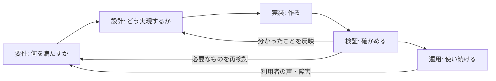
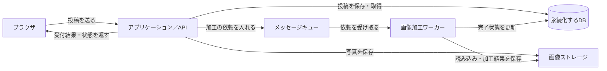

# ソリューショニングとプロトタイピング

[講義スライド（65枚）](./slides/index.html) ／ [レビュー用一覧](./slides/review.html) ／ [資料・コピー用プロンプト](./slides/workbook.html)

**今日の問い：担当者が違っても、変更を安全につなげられるか？**

作る前に必要なつなぎ目を決め、早くつなぎ、変更後に確かめます。設計は一度書いて終わりではなく、試して分かったことに合わせて更新します。

## 目次

- [3限目: 設計 — 構造を理解して、変更する](#3限目-設計--構造を理解して変更する)
  - [1. イントロダクションと準備 (14分)](#1-イントロダクションと準備-14分)
  - [2. 開発プロセスと設計の位置 (3分)](#2-開発プロセスと設計の位置-3分)
  - [3. 要件と確かめ方 (7分)](#3-要件と確かめ方-7分)
  - [4. 演習D-1: まず作って、確かめる (8分)](#4-演習d-1-まず作って確かめる-8分)
  - [5. 変更を頼まれたら、どこを直す？ (6分)](#5-変更を頼まれたらどこを直す-6分)
  - [6. 結果から考える (6分)](#6-結果から考える-6分)
  - [7. アーキテクチャ: 部品を組み合わせる (14分)](#7-アーキテクチャ-部品を組み合わせる-14分)
  - [8. つなぎ目を契約にする (8分)](#8-つなぎ目を契約にする-8分)
  - [9. AIと設計を比較・レビューする (8分)](#9-aiと設計を比較レビューする-8分)
  - [10. 演習D-2: 設計して、日付の絞り込みを追加する (24分)](#10-演習d-2-設計して日付の絞り込みを追加する-24分)
  - [11. 3限目まとめ (2分)](#11-3限目まとめ-2分)
- [4限目: アーキテクチャ案を比較し、チームで決める](#4限目-アーキテクチャ案を比較しチームで決める)
  - [12. チームを作り、共通のお題を理解する (6分)](#12-チームを作り共通のお題を理解する-6分)
  - [13. 案の比べ方と図の描き方を知る (8分)](#13-案の比べ方と図の描き方を知る-8分)
  - [14. 演習F-1: 各自、AIと複数案を考えて理解する (16分)](#14-演習f-1-各自aiと複数案を考えて理解する-16分)
  - [15. 演習F-2: draw.ioで案を並べ、一つ選ぶ (12分)](#15-演習f-2-drawioで案を並べ一つ選ぶ-12分)
  - [16. 演習F-3: 図と選んだ理由を持ち寄る (12分)](#16-演習f-3-図と選んだ理由を持ち寄る-12分)
  - [17. 演習F-4: チームで一つに決める (12分)](#17-演習f-4-チームで一つに決める-12分)
  - [18. 演習F-5: 重要な判断を小さく確かめる (14分)](#18-演習f-5-重要な判断を小さく確かめる-14分)
  - [19. 別のチームのレビューを受けて見直す (12分)](#19-別のチームのレビューを受けて見直す-12分)
  - [20. 個人の説明・まとめ (8分)](#20-個人の説明まとめ-8分)
- [課題と評価](#課題と評価)
  - [提出物](#提出物)
  - [到達の目安](#到達の目安)
  - [事後学習](#事後学習)
  - [次回予告](#次回予告)
- [講師の事前準備](#講師の事前準備)
- [発展: 実装・統合へ進むとき](#発展-実装統合へ進むとき)
- [参考](#参考)

---

# 3限目: 設計 — 構造を理解して、変更する

| # | 内容 | 時間 | 形式 |
| --- | --- | --- | --- |
| 1 | イントロダクションと準備 | 14分 | 講義＋各自 |
| 2 | 開発プロセスと設計の位置 | 3分 | 講義 |
| 3 | 要件と確かめ方 | 7分 | 講義＋問い |
| 4 | 演習D-1: まず作って、確かめる | 8分 | 個人・ペアで相談可 |
| 5 | 変更を頼まれたら、どこを直す？ | 6分 | 個人 |
| 6 | 結果から考える | 6分 | 投稿＋共有 |
| 7 | アーキテクチャ: 部品を組み合わせる | 14分 | 講義＋構成を選ぶ問い |
| 8 | つなぎ目を契約にする | 8分 | 講義＋具体例 |
| 9 | AIと設計を比較・レビューする | 8分 | 講師実演 |
| 10 | 演習D-2: 設計して、日付の絞り込みを追加する | 24分 | 個人・ペアで説明 |
| 11 | 3限目まとめ | 2分 | 個人メモ |
| | **合計** | **100分** | |

## 1. イントロダクションと準備 (14分)

### 1.1 この演習の全体像（7回）

本演習は全7回（1回あたり2コマ・各100分）です。シラバス上は全14回ですが、内容の近い2回分をまとめて1日で実施します。**今日は第4回**です。

| 回数 | 1 | 2 | 3 | **4** | 5 | 6 | 7 |
| --- | --- | --- | --- | --- | --- | --- | --- |
| テーマ | ソリューション基礎 | ソフトウェア開発方法論とアジャイルワークショップ | デザイン思考を用いたユーザー中心のデザイン | **ソリューショニングとプロトタイピング** | 対話と問いを用いた価値のデザイン | ケーススタディ: デザインと演習問題 | ケーススタディ: ソリューショニングと成果発表 |
| シラバス回 | 第1-2回 | 第7-8回 | 第3-4回 | **第9-10回** | 第5-6回 | 第11-12回 | 第13-14回 |
| 担当講師 | 小島、竹田 | 小島 | 竹田 | **小島** | 竹田 | 小島、竹田 | 小島、竹田 |

7回は、次のストーリーでつながっています。

1. **ソリューションの考え方**を身につける（第1回 ✅ 済み）
2. **開発の進め方**（ウォーターフォール / アジャイル / 仕様駆動）を理解する（第2回 ✅ 済み）
3. **ユーザー中心のデザイン思考**を学ぶ（第3回 ✅ 済み）
4. **ソリューショニングとプロトタイピング**（**第4回 ← 今日**）
5. **対話や問い**を通じて価値の認識を合わせる力を磨く（第5回）
6. **ケーススタディ**で学びを統合し、自分たちのソリューションを設計・発表する（第6-7回）

今日つくる**アーキテクチャ図**と**技術選択の理由**は、期末評価の観点1「アーキテクチャ基礎の理解」と観点5「テクノロジーを活用した問題解決手法の理解」に、そのまま対応します。

### 1.2 前回までとのつながり

- **第2回**：受け入れ条件を書いて確かめること、チームで進め方を工夫することを体験しました。うまくいったこと・難しかったことを一つ思い出してください。
- **第3回**：ユーザーを理解し、誰のどんな問題を解くかを考えました。ユーザー理解は要望を集めるときだけでなく、設計案を選び、プロトタイプを評価するときにも使います。
- **今日**：何を作るかに加えて、**どう分け、どうつなぎ、変更にどう対応するか**を考えます。

### 1.3 今日のゴール

| | 授業後にできること |
| --- | --- |
| 3限目 | 部品とデータの流れを図にし、変更する場所と、その設計を選んだ理由を説明できる |
| 4限目 | AIと複数のアーキテクチャ案を理解・比較し、図と理由を持ち寄り、チームで選択・検証できる |

> **先に合意する。早くつなぐ。変更後に確かめる。**

今日の必須実装はブラウザ内の小さなアプリです。データベースやメッセージキューは、実際のサービスへ育てるときの**設計上の選択肢**として学びます。授業中にこれらのサーバーを構築する必要はありません。

### 1.4 今日の作業フォルダを作る

第2回と同じ形で、今日の置き場所を作ります。**まずフォルダを作ってから**、中身を入れていきます。

```
ソフトウェア開発演習/          ← 第2回で作ったもの
└── 第4回/                    ← 今日のフォルダ（これから作る）
    └── starter-windows/      ← このあとダウンロードして展開する（Macは starter-mac）
```

**Windowsの人**

1. デスクトップの `ソフトウェア開発演習` フォルダを開く（第2回で作ったもの。無ければデスクトップで右クリック → **新規作成** → **フォルダー** で作る）
2. その中で右クリック → **新規作成** → **フォルダー**
3. 名前を **`第4回`** にして `Enter`

**Macの人**

1. デスクトップの `ソフトウェア開発演習` フォルダを開く（無ければデスクトップで右クリック → **新規フォルダ**）
2. その中で右クリック → **新規フォルダ**
3. 名前を **`第4回`** にして `Enter`

### 1.5 Spec Kit の入ったフォルダをダウンロードする

第2回で使ったものと**同じファイル**です。自分のOSのリンクをクリックしてください。

| 自分のPC | ダウンロードリンク | サイズ |
| --- | --- | --- |
| **Windows** | 👉 **[starter-windows.zip をダウンロード](https://raw.githubusercontent.com/Creative-Cucumbers/solution-design-with-technology/main/2026/2_software_development_methodology_agile/starter-windows.zip)** | 約90KB |
| **Mac / Linux** | 👉 **[starter-mac.zip をダウンロード](https://raw.githubusercontent.com/Creative-Cucumbers/solution-design-with-technology/main/2026/2_software_development_methodology_agile/starter-mac.zip)** | 約92KB |

1. 自分のOSのリンクをクリックする（クリックするとダウンロードが始まります）
   - 始まらない場合は、**右クリック → 「名前を付けてリンク先を保存」**
2. ダウンロードしたZIPを、いま作った **`ソフトウェア開発演習/第4回`** に移動する
3. ZIPを**展開（解凍）**する
   - Windows: 右クリック → **すべて展開** → そのまま **展開**
   - Mac: ダブルクリック
4. `第4回` の中に **`starter-windows`**（Macは `starter-mac`）ができていればOK

> [!IMPORTANT]
> **第2回で使ったフォルダを使い回さず、新しく落としてください。** 前回の `specs/` が残っていると、今日作るものと混ざります。

> [!NOTE]
> 展開したフォルダを開いても、中身がほとんど見えません（設定ファイルが**隠しファイル**として入っているためです）。**空に見えても正常です。**

### 1.6 Antigravity IDE で開く

1. Antigravity IDE を起動する
2. メニューから **ファイル** → **フォルダーを開く**（英語なら `File` → `Open Folder`）
3. **`ソフトウェア開発演習/第4回/starter-windows`**（Macは `starter-mac`）を選ぶ
4. チャットで **`/speckit-`** と打って、コマンドの一覧が出れば準備完了

> [!WARNING]
> **開くのは `starter-windows` / `starter-mac` そのものです。** 親フォルダ（`第4回`）を開くと、`/speckit-*` が出てきません。
> 出てこない場合は、開いたフォルダを確認してから、ウィンドウを再読み込みしてください。

### 1.7 図を描く拡張機能を入れる

今日は**図を描く拡張機能**を1つ足します。

> [!NOTE]
> **Draw.io Integration を入れる**
>
> 1. キーボードで **`Ctrl` + `Shift` + `X`**（Macは **`Cmd` + `Shift` + `X`**）を押す → 左側に拡張機能の一覧が開く
> 2. 検索欄に **`Draw.io Integration`** と入力する
> 3. 作者が **Henning Dieterichs** のものを選び、**Install** を押す
> 4. 入ったか確かめる: ファイルを新規作成して、名前を **`test.drawio.svg`** にする → 四角や矢印を描く画面が開けば成功
>
> **ファイル名の末尾を `.drawio.svg` にするのが大事です。** この拡張機能は、拡張子を見て編集画面を出すかどうかを決めています。

> [!TIP]
> 入らない場合は、ブラウザ版の [app.diagrams.net](https://app.diagrams.net/) を使ってください。ログインは不要です。描いた図は「ファイル → 形式を指定してエクスポート → SVG」で保存できます。

### 1.8 準備チェック

- [ ] `ソフトウェア開発演習/第4回` フォルダを作った
- [ ] 自分のOSのZIPをダウンロードして、`第4回` の中で展開した
- [ ] Antigravity IDE で `starter-windows`（Macは `starter-mac`）を開いた
- [ ] チャットで `/speckit-` と打ってコマンドが出た
- [ ] Draw.io Integration を入れた

**詰まったら、すぐ手を挙げてください。** 演習は2人1組で相談しながら進めるので、自分のPCが動かないときはペアの画面を一緒に見て参加できます。

---

## 2. 開発プロセスと設計の位置 (3分)



これは活動の関係です。**全部を一度だけ順番に終える、という意味ではありません。** 小さい単位で行き来します。

| 第2回で使ったもの | 今日の位置づけ |
| --- | --- |
| `/speckit-specify` → `spec.md` | 満たす条件を整理する |
| `/speckit-plan` → `plan.md` | 構成・技術・実現方法を設計する |
| `/speckit-tasks` → `tasks.md` | 作業を分ける |
| `/speckit-implement` | 実装する |
| 受け入れ条件で確認 | 結果を検証する |

今日は設計の重要な判断を短い `design.md` に残します。これは**この授業で追加するメモ**で、Spec Kitの標準工程として必須のファイルではありません。更新したら、仕様・計画・コードとの食い違いも確認します。

## 3. 要件と確かめ方 (7分)

### 3.1 願いを、確かめられる条件にする

この授業では、次のように整理します。要望・要求・要件という言葉の区別は、組織や文献によって異なります。

| 段階 | 落とし物掲示板の例 |
| --- | --- |
| 要望: ユーザーの願い | 落とした傘を早く見つけたい |
| 要求: 必要なこと | 場所で絞って探したい |
| 要件: 作る側が満たす条件 | 「図書館」を選ぶと、拾った場所が「図書館」の投稿だけを表示する |
| 受け入れ条件: 合否を判断する具体例 | 図書館2件・食堂1件のデータで、図書館を選ぶと2件だけ表示される |

**問い：0件だったとき、何を表示すればユーザーは次の行動を取れますか？**

### 3.2 機能と品質の両方を見る

| 観点 | 例 | 確認するために決めること |
| --- | --- | --- |
| 機能 | 投稿・検索・削除ができる | 入力、期待する結果、失敗時の振る舞い |
| 品質・制約 | 指定のスマホ幅で操作できる | 画面幅、対象ブラウザ、操作の条件 |
| 品質・制約 | 一覧が3秒以内に表示される | 件数、端末、通信、測定する区間 |

「他人の投稿を消せない」はセキュリティ上の要求で、本人確認と削除権限という具体的な機能にも落とせます。分類より、**どう満たし、どう確かめるか**が大切です。

今日のアプリは本人確認も共有保存も省いた試作品です。実際の学内サービスとして使う場合は、これらを追加して検証する必要があります。

### 3.3 整理する道具

ユーザーの行動にはストーリーマップ、画面にはワイヤーフレーム、データの関係にはデータモデルが使えます。今日は**部品の図、契約、具体的な確認例**に絞ります。全部の種類の資料を作る必要はありません。

## 4. 演習D-1: まず作って、確かめる (8分)

### 4.1 お題と受け入れ条件

**学内の落とし物掲示板**を作ります。

| | 条件 |
| --- | --- |
| AC1 | 品名・拾った場所・拾った日を入力して投稿できる |
| AC2 | 投稿された落とし物を一覧で見られる |
| AC3 | 選んだ投稿だけを削除できる。同じ品名の別の投稿は残る |

比較に使うデータは全員同じにします。変更前後で、毎回この3件を新しく登録してください。

| 品名 | 拾った場所 | 拾った日 |
| --- | --- | --- |
| 傘 | 図書館 | 2026-10-10 |
| 傘 | 食堂 | 2026-10-11 |
| ノート | 図書館 | 2026-10-12 |

### 4.2 作る

準備したフォルダで、順にエージェントへ送ります。

```text
/speckit-specify 学内の落とし物掲示板を作ります。
受け入れ条件:
- 品名・拾った場所・拾った日を入力して投稿できる
- 投稿された落とし物を一覧で見られる
- 選んだ投稿だけを削除できる。同じ品名の別の投稿は残る
制約:
- ブラウザ内だけで動く。アプリの実行にサーバーやネット接続は不要
- データはメモリ内だけに持つ。リロードで消えてよい
- 外部ライブラリ、ログイン、外部サービスは使わない
```

```text
/speckit-plan
```

今回は `plan.md` の詳しいレビューを後に回し、続けて実装します。**AIによる設計は存在しています。人がまだ理解・確認していない状態を観察する演習です。**

```text
/speckit-tasks
```

```text
/speckit-implement
```

作成したアプリをブラウザで開き、3件を登録してAC1〜AC3を確認します。削除したら、次の確認の前に同じ3件に戻してください。

> [!NOTE]
> 8分で未完了なら、止まった工程を記録して講師の基準版に切り替えます。自分の生成物か基準版かを記録してください。AIの生成待ちの長さで学習機会が変わらないようにします。

## 5. 変更を頼まれたら、どこを直す？ (6分)

追加依頼は一つです。

> 「拾った場所を選んで絞り込みたい。選ばなければ全部表示してほしい」

### 5.1 まず予測する (2分)

まだAIに変更を頼まず、コードや計画を見てメモします。

- どの部品を直すと思うか。
- データの持ち方は変える必要があるか。
- 変更後、何を確認すればよいか。

分からなければ「不明」で構いません。説明できる人は、その手がかりを書いてください。

### 5.2 変更し、同じ条件で確かめる (4分)

AIに場所の絞り込みを依頼します。実装できたら同じ3件を登録し直して確認します。

| 確認 | 期待する結果 |
| --- | --- |
| 場所を指定しない | 3件出る |
| 図書館を選ぶ | 傘とノートの2件だけ出る |
| 該当する投稿のない場所を指定する | 0件であることが分かる |
| 元の投稿・一覧・削除 | AC1〜AC3が引き続き通る |

**リロードでデータが消えることは今回の仕様どおりです。設計の失敗とは判定しません。** 未完了の場合は、予測と現在の差分だけを残します。

AIには「変更した箇所と理由を報告し、コードは変えないで」と依頼しても構いません。ただし、報告は差分や実際の動作と照合します。変更行数の多さだけで設計の良し悪しは決まりません。

## 6. 結果から考える (6分)

Slackの「第4回 考えてみよう」スレッドへ、3分で投稿します。続く3分でいくつか共有します。

```text
使ったもの: 自分の生成物 / 講師の基準版
予測した変更箇所:
実際に変更した箇所:
確認した結果:
次に知りたいこと:
```

- 予測が当たった人：どの情報が役立ちましたか？
- 予測と違った人：どのつながりを見落としていましたか？
- 壊れた人：観察できた事実と、原因の推測を分けてください。
- 未完了の人：次に何を確認すれば進められそうですか？

**動いた・動かなかったのどちらも教材です。** AIが決めたこと自体を失敗とはしません。人が理由を理解し、変更の影響を確認できるかが今日の問いです。

## 7. アーキテクチャ: 部品を組み合わせる (14分)

### 7.1 設計とアーキテクチャ (2分)

**設計とは、求められることを実現するために、「誰が何をするか」「どんな情報を扱うか」「どうやり取りし、動くか」を決め、理由を説明することです。**

その中でも、全体の構造や重要な品質に関わる判断を**アーキテクチャ**として扱います。例えば「全員が同じ投稿を見るため、データをサーバーで共有する」は全体構成の判断です。「日付の入力エラーをどの文言で表示するか」は、より細かな設計です。境界は文脈によって変わります。

設計図や文書は、判断を伝える道具です。最初に全部を決め切る必要はありません。**変更で困りそうな部分を先に考え、小さく作って見直します。**

### 7.2 コンポーネント: 役割を持つ部品 (2分)

コンポーネントは、ここでは**担当する仕事と、ほかの部品とのやり取りがある部品**と考えます。サービス全体を見渡すと、例えば次のような役割があります。

| 役割による分類 | やさしく言うと | 落とし物サービスでの例 |
| --- | --- | --- |
| **画面・ユーザーインターフェース（UI）** | 人が見たり操作したりするところ | 投稿フォーム、落とし物の一覧 |
| **コンピュート** | 調べる・計算する・加工するところ | 投稿内容を確認する処理、写真を縮小する処理、ワーカー |
| **ストレージ・データ管理** | 情報を置き、必要なときに取り出すところ | 投稿を保存するDB、写真の保存先 |
| **通信・メッセージング** | 部品どうしをつなぎ、情報や依頼を届けるところ | ネットワーク、通信の窓口、処理依頼を渡すメッセージキュー |

これは**役割を理解するための分類**です。一つの製品が複数の役割を担うこともあります。例えばキューは依頼を一時的に保存しますが、主な役割は処理する側へ受け渡すことです。

コンピュートは、クラウドでは処理を動かす仮想マシンやコンテナ等の実行環境も指します。今日は、まず「処理する」「保存する」「つなぐ」を区別して考えます。

**部品の数とファイルの数は、必ずしも同じではありません。** 一つのプログラム内でも役割を分けられますし、別のサーバーへ分けることもできます。

身近な投稿フォームや一覧も部品です。その裏側でコンピュートが入力を確認し、ストレージへ保存し、通信を通じてほかの人へ情報を届けます。**今回は、この全体像のうち「情報をどこに、どのように置くか」を詳しく見ます。**

### 7.3 保存・速度・待ち時間に応じて部品を選ぶ (4分)

ストレージ・データ管理を考えるときは、まず「処理中だけ使う情報か」「翌日も残す情報か」「文章や一覧か、写真などのファイルか」を分けます。次は、**情報を置くために組み合わせる代表的な媒体・仕組み・使い方**です。

| 種類 | やさしく言うと・役割 | 落とし物サービスでの例 | 選ぶときの注意 |
| --- | --- | --- | --- |
| **メモリ（RAM）** | 処理中の情報をすばやく読み書きする作業机 | 今日のアプリの投稿一覧、検索途中の値 | 一般的なRAMは速いが**揮発性（電源を切ると内容が失われる性質）**がある。ページ内の変数もリロードで失われる |
| **データベース（DB）** | 情報を整理し、探したり書き換えたりする仕組み | 投稿、受け取り状況、履歴 | SSDなどへ**永続化（終了・再起動後にも使えるよう残すこと）**する構成なら、保存した情報を復元できる。故障や誤削除に備えたバックアップ等も考える |
| **ファイル／オブジェクトストレージ** | 写真などをファイル単位・オブジェクト単位で置く保存場所 | 落とし物の写真 | 投稿の情報はDB、写真本体は別の保存場所、という組み合わせもある。誰が見られるか、投稿と一緒に消すかを決める |
| **キャッシュ** | よく使う結果を一時的に置く控え | よく検索される場所の結果 | メモリを使うことが多い。元の情報が変わると古い控えになるため、いつ更新・破棄するかを決める |

> [!NOTE]
> **メモリとDBは、完全な二択ではありません。** RAMは記憶媒体、DBは情報を管理する仕組み、キャッシュは情報の使い方です。DBもメモリを使い、メモリ中心のDBにも永続化機能があります。速度は処理・通信・データ量にも左右され、「DBは必ず遅い」とは言えません。
>
> **永続性も、絶対に失われないという意味ではありません。** どの時点まで保存され、どんな故障から回復できるかを設計・設定します。[Redisの永続化の説明](https://redis.io/docs/latest/management/persistence/)

今日のブラウザ内の試作品は、作業机にだけ情報を置く構成です。実際に翌日も使うなら、残しておく保存場所が必要になります。**保存先を選んだら、次は「いつ処理し、いつ結果を返すか」を考えます。**

### 7.4 同期と非同期を組み合わせる (3分)

ここで、保存する部品に加えて、**仕事を渡す部品と、実行する部品**を組み合わせます。

| 部品 | 分類・役割 | 例 |
| --- | --- | --- |
| **メッセージキュー** | メッセージング：仕事の依頼を受け取り、処理する側へ渡す | 写真加工の依頼をためる。キュー自身は写真を加工しない |
| **ワーカー** | コンピュート：依頼を受けて実際に処理する | 写真を読み、縮小し、結果を保存する |


- **同期的なやり取り**：依頼した側が、その処理結果を待つ。例：投稿の保存結果を受け取ってから「登録しました」と表示する。
- **非同期的なやり取り**：受け付けと完了を分ける。例：写真の加工を受け付け、画面には「処理中」と表示し、後で結果を反映する。



図は、投稿を保存して受付結果を返し、重い写真加工を後で行う構成例です。ブラウザは後から状態を取得し、完了した写真を表示します。**非同期にしても仕事そのものが速くなるとは限りません。利用者が待つ範囲や、混雑時の処理の仕方を変えられます。**

例えば通知だけが失敗しても投稿を残したいなら、投稿と通知の処理を分ける意味があります。その代わり「投稿は保存できたが、処理依頼を送れなかった場合」への対処も必要です。

キューの永続化や処理完了の確認は設定・実装が必要です。再配信されることもあるため、例えば依頼IDで処理済みかを確認します。**キューを入れれば自動的に、必ず一度だけ処理されるわけではありません。** [RabbitMQのワークキュー教材](https://www.rabbitmq.com/tutorials/tutorial-two-javascript)

### 7.5 構成を選んでみる (3分)

隣の人と、次の条件に必要な部品と、まだ要らない部品を選びます。

| 条件 | 考える問い |
| --- | --- |
| 今日の授業だけで、画面の使いやすさを試す | メモリだけでも目的を満たせるか？ |
| 別の学生の端末でも同じ投稿を見たい。翌日も残したい | 共有するデータの置き場と、アクセスする窓口は？ |
| 写真加工に30秒かかる。投稿画面では待たせたくない | 受付と完了をどう分け、状態をどう伝えるか？ |

**部品をたくさん入れるほどよい設計になるわけではありません。** 得られる品質と、開発・運用・理解の負担を比べます。小さなアプリでも責務を分けられますし、DBやキューを使うだけでマイクロサービスになるわけでもありません。

> **図に部品を足す前に、「誰の、どんな困りごとのためか」を言ってみてください。**

## 8. つなぎ目を契約にする (8分)

### 8.1 決めるのは、名前だけではない

契約は、部品どうしで共有する約束です。

| 設計で使う言葉 | やさしく言うと・考える問い | 落とし物の例 |
| --- | --- | --- |
| **データ** | **扱う情報**。何を覚えておく？ | 投稿を区別する番号、品名、拾った場所、拾った日を持つ |
| **責務** | **担当する仕事**。どの部品が何をする？ | データ管理が投稿の番号を付ける。一覧の部品は表示を担当する |
| **入出力** | **渡すもの・返ってくるもの**。何を頼み、どんな答えを受け取る？ | 削除したい投稿の番号を渡すと、削除できたかどうかが返る |
| **失敗・境界** | **うまくいかないとき・ぎりぎりの条件での動き**。空欄、0件、日付の端では？ | 品名が空なら追加せず理由を返す。日付で絞るなら開始日当日を含むか決める |
| **更新の通知** | **変わったことの伝え方**。誰が、誰に、何を知らせる？ | 投稿や削除が成功したら、一覧の部品に表示し直してもらう |

例えば `removeItem(id)` は「この番号の投稿を消して」というお願いです。`true`／`false` は「削除できた／できなかった」という返事です。**まず日本語で意味を理解してから、プログラムで使う表記と結び付けます。**

**同じ品名でも、同じ落とし物とは限りません。** 名前ではなくIDで区別する理由を、3件のサンプルで説明してください。

### 8.2 今日の共通の接続方法

3限の基準版で部品の対応を追いやすくするため、接続方法は共通にします。これは授業用の選択で、すべての開発で使う唯一の方式ではありません。

| ファイル | 責務・接点 |
| --- | --- |
| `index.html` | 入力・一覧の配置先を定義し、`data.js` → `list.js` → `post.js` の順に通常のscriptで読み込む |
| `data.js` | `window.board` にデータ操作の関数を公開。メモリ内の配列は外部に直接公開しない |
| `list.js` | `window.renderList()` を公開。自分で検索条件を読み、`board.getItems(条件)` の結果を表示 |
| `post.js` | フォームを読み、`board.addItem(入力)` が成功したら `renderList()` を呼ぶ |

配置先IDは `post-form`、`item-name`、`item-place`、`item-date`、`post-error`、`filter-place`、`item-list`、`list-status` とします。初期表示と削除後の再表示は `list.js` が担当します。

内部の配列を隠し、操作だけを公開しておけば、保存方法を変えるときに影響を絞れる可能性があります。ただし、通信を伴う保存に変えるなら、非同期の戻り値や失敗処理など、契約の見直しも必要です。

### 8.3 一つの約束を、具体例で確かめる

「図書館で絞る」とき、部分一致か完全一致か？ 条件なしは全件か？ 該当なしは空配列か？

**担当者が同じ具体例に同じ答えを返せるか**を確認します。書かれていないことに気づいたら、決めてから進みます。

## 9. AIと設計を比較・レビューする (8分)

講師が一つの判断を実演します。学生は、選んだ理由を一文でメモしてください。

### 9.1 案を比較する

```text
落とし物掲示板の「場所による絞り込み」を設計します。実装はまだしないでください。
画面側で絞る案と、データ管理のgetItemsに条件を渡す案を比べてください。
- 今回の小さなアプリでの利点と負担
- あとから日付でも絞る場合に変わる部品
- 私が確認・決定すべきこと
を短く説明してください。今のコードと違う前提には印をつけてください。
```

「どちらが有名か」より、今回の条件で比較します。例えば表示と検索ルールを別々に変更したいならデータ管理側に寄せる理由になりますが、部品間の約束が増える負担もあります。

### 9.2 AIと下書きを作り、人が意味を確かめる

**`design.md` を学生だけで白紙から書く必要はありません。** AIに分からない言葉を説明してもらい、質問に答え、下書きを整えてもらいます。人は「何を選ぶか」と「その説明に納得できるか」を確かめます。

9.1で比較した案について、次のプロンプト全体をコピーし、「私が選びたい案」と「大切にしたいこと」を書き換えて送ってください。設計メモのひな形も含まれています。

```text
今の比較をもとに、design.mdを一緒に作ってください。
私は設計書を書いた経験がありません。コードはまだ変更しないでください。

私が選びたい案: （案の名前。迷っている場合は「まだ迷っている」）
大切にしたいこと: （自分の言葉で一つ）

1. 足りない判断を、具体例と選択肢のある質問にして、一問ずつ聞いてください。
   私の回答を待ち、専門用語は言い換えてください。
2. 回答をもとに、下のひな形で短い下書きを示してください。
   私が決めていないことは「要確認」とし、勝手に決定事項にしないでください。
3. 下書きの各項目を、傘1件を投稿・検索する例で説明してください。
4. 私が一つの操作を言い直すので、下書きと食い違わないか確認してください。
5. 私が確認したらdesign.mdへ保存してください。

以下のひな形を使ってください。

# 設計メモ
## できるようにしたいこと・今回は作らないこと
## 部品ごとの担当する仕事（責務）
## 部品どうしの約束（契約）
- 扱う情報（データ）:
- 渡すもの・返ってくるもの（入出力）:
- うまくいかないとき・ぎりぎりの条件での動き（失敗・境界）:
- 変わったことの伝え方（更新の通知）:
## 選んだ理由
- 比べた案:
- 選んだ案と理由:
- 不便になること・増える手間:
- 選び直したほうがよい条件:
## 確かめる例（操作 → 期待する結果）
## 変更した記録（いつ / 何を / 影響する部品 / 相談した人）
```

下書きができたら、「図書館の傘を投稿すると、どの部品に何が渡るか」を自分で言ってみます。分からない行はAIに聞き直し、説明できる言葉に直します。未解決の点は「要確認」のままペアや講師に相談してください。

重要な判断の背景・選択・結果を残す考え方を、**ADR（アーキテクチャ上の決定記録）**と呼びます。今日は一つの判断を短く残せれば十分です。

### 9.3 AIの案と実装を確かめる

```text
/speckit-plan design.md の合意を前提に、現在の実装からの変更を計画してください。
今回の変更は場所による絞り込みだけです。
変更する部品、維持する契約、確認する受け入れ条件を書いてください。
決まっていないことは勝手に補わず、質問してください。
```

人が確認するのは、契約に合っているか、余計な変更がないか、確かめ方があるかです。AIへの指示だけで遵守が保証されるわけではないので、結果も確認します。図と文章は、どちらも人とAIの理解を支える資料です。

## 10. 演習D-2: 設計して、日付の絞り込みを追加する (24分)

### 10.1 今回やることと、完成した姿

**5節で場所の絞り込みを追加した落とし物掲示板に、「拾った日で絞り込む」機能を一つ追加します。** 今度は、AIにすぐ実装させず、どの部品が検索を担当するかを選んでから作ります。

完成した画面では、例えば次の操作ができます。

> 場所を「図書館」、拾った日を「2026-10-12」にする → 「ノート」1件が表示される。日付を空欄に戻す → 図書館の「傘」と「ノート」の2件に戻る。

今回は**一日を指定して探す**機能です。開始日〜終了日の範囲検索は作りません。場所も日付も指定したら、**両方に合う投稿だけ**を出します。

| 入力 | 決めておく動き |
| --- | --- |
| 場所も日付も空欄 | 全件表示する |
| 場所だけ指定 | 今までどおり、その場所の投稿を表示する |
| 日付だけ指定 | その日に拾った投稿を表示する |
| 両方指定 | 場所と日付の両方に合う投稿を表示する |
| 該当する投稿がない | 「該当する投稿はありません」と表示する |

### 10.2 作業を始める場所

1. **5節の作業フォルダを複製**し、元の版を残します。複製したほうをAntigravity IDEで開きます。
2. 投稿・一覧・削除・場所の絞り込みが動くことを確かめます。未完了なら、講師の基準版を複製して始めます。
3. 使ったのが自分の版か基準版か、メモします。新しいアプリを一から作る必要はありません。

**人がすることは「説明を聞く・案を選ぶ・結果を確かめる」。AIには「調べる・下書きする・実装する」を手伝ってもらいます。**

### 10.3 手順① 今の作りをAIに説明してもらう (4分)

作業フォルダを開いたチャットへ送ります。

```text
このフォルダの落とし物掲示板を読み、説明だけしてください。まだ変更しないでください。
これから、場所に加えて「拾った日を一日指定して絞る」機能を追加します。

今の「図書館を選ぶと、図書館の投稿だけが出る」操作について、
- 条件を受け取るところ
- 条件に合う投稿を探すところ
- 結果を画面に出すところ
を、実際のファイル名と対応させて説明してください。
初心者向けに、四角3つと矢印で描ける短い説明にしてください。
分からない点は推測で断定しないでください。
```

説明を見ながら、図のひな形に担当する仕事とファイル名を書きます。分からないところは「傘1件の例で」と聞き返してください。

### 10.4 手順② 日付で探す仕事を、どこに置くか選ぶ (4分)

続けてAIに相談します。

```text
日付で絞る仕事を、次の2案で比べてください。まだ実装しないでください。
A: 画面を担当する部品が、取得した投稿から場所・日付に合うものを選ぶ。
B: データを管理する部品に場所・日付を渡し、合う投稿を返してもらう。

場所も日付も空欄なら全件、片方だけならその条件、両方なら両条件に一致する投稿を表示します。
日付は一日だけで、範囲検索はしません。
今の作りからどこを変えるか、利点と増える手間を各案短く説明してください。
選ぶために私が答えるべきことがあれば、一問ずつ聞いてください。
```

A・Bのどちらかを選びます。どちらを選んでも構いません。「今回は＿＿を優先するので＿＿案」と言えることが大切です。

### 10.5 手順③ AIと設計メモを作り、ペアに説明する (5分)

次の文の案と理由を入れて送ります。

```text
私は【AまたはB】を選びます。理由は【自分の言葉で一文】です。
今回の日付の絞り込みについて、design.mdの下書きを作ってください。
まだアプリのコードは変更しないでください。

- 選んだ案と理由
- どのファイルが、入力・検索・表示を担当するか
- 部品へ何を渡し、何を返してもらうか
- 空欄・0件のときの動き
- 変更する場所と、確認する例
を短く書き、技術用語には言い換えを付けてください。
分からない点は「要確認」にしてください。私が確認してから保存してください。
```

下書きの意味を聞いてから、ペアへ**「図書館・10月12日で探すとき、どこに何を渡し、何が返るか」**を説明します。ペアは「日付を空欄に戻したら？」と聞き返します。説明が違ったらAIと下書きを直します。決めた担当を図にも反映してください。

### 10.6 手順④ 決めた案で、日付の絞り込みを追加する (7分)

まず、現在のSpec Kitの仕様と計画に今回の変更を反映させます。

```text
今回の対象のspec.mdに、日付による絞り込みの条件を追加してください。
対象ファイルを確認してから、元の投稿・一覧・削除・場所検索の条件を維持して更新してください。
アプリはまだ変更せず、追加した条件を示してください。
```

条件を確認して、続けて送ります。

```text
/speckit-plan 更新したspec.mdとdesign.mdに従い、日付の絞り込みを追加する計画を作ってください。
今のアプリをもとにし、必要な部分だけ変更してください。
投稿・一覧・削除・場所検索は引き続き使えるようにしてください。
```

変更する部品が選んだ案と合っているかを見て、順に進めます。

```text
/speckit-tasks
```

```text
/speckit-implement
```

この時間に間に合わなければ、AIの作業がどこまで進んだかを記録して確認へ進みます。講師の基準版に切り替えた場合も、Spec Kitの設定と今回の仕様を含むフォルダを使います。

### 10.7 手順⑤ 同じ3件で、自分で確かめる (4分)

アプリを開き直し、4.1の3件を登録し直します。AIの「完成しました」だけで終わらず、自分で操作し、次の表に結果を書いてください。

| 操作 | 期待する結果 | 結果（○／×／未確認） |
| --- | --- | --- |
| 場所・日付とも空欄 | 3件 | |
| 図書館、日付は空欄 | 図書館の傘・ノートの2件 | |
| 場所は空欄、2026-10-11 | 食堂の傘1件 | |
| 図書館、2026-10-12 | ノート1件 | |
| 図書館、2026-10-11 | 0件のメッセージ | |
| 両方空欄に戻し、図書館の傘だけ削除 | 食堂の傘とノートが残る | |

最初の3件を登録して一覧に出ることが、投稿・一覧の確認にもなります。削除の確認は最後に行います。リロードで情報が消えるのは今回の仕様どおりです。

最後に「予測した変更箇所と実際は同じだったか」「違ったなら何が分かったか」を一文で残します。

### 10.8 ここまで残せれば、演習の成果になる

- **`design.md`**：選んだ案・理由・担当する部品・やり取りが、自分で説明できる。
- **図1枚**：日付で探す流れが分かる。draw.ioでも紙の写真でもよい。
- **変更したアプリと確認表**：上の操作を確かめ、未完了・未確認も区別する。
- **比較の一文**：予測と実際から気づいたこと。

実装が未完了でも、設計メモ・図・現在の確認結果を残してください。既に日付検索がある場合は、この条件と自分が選んだ担当の分け方に合うかを確認し、必要な箇所だけ修正します。

**D-1とD-2は同じ課題をやり直す厳密な比較実験ではありません。** 「速くなったから設計が正しい」とは判断せず、設計メモが変更の予測や確認にどう役立ったかを説明してください。

## 11. 3限目まとめ (2分)

次の文を埋めてください。

> 私は＿＿を＿＿の部品に担当させた。理由は＿＿。次に＿＿が必要になったら、この判断を見直す。

メモリ、DB、キューも同じです。**必要な品質を満たすために選び、理由と負担を説明します。**

---

# 4限目: アーキテクチャ案を比較し、チームで決める

**各自が複数案を理解して選び、図と理由を持ち寄ります。** チームで一つの案に合意し、その案の重要な部分を小さく確かめます。

| # | 内容 | 時間 | 形式 |
| --- | --- | --- | --- |
| 12 | チームを作り、共通のお題を理解する | 6分 | チーム |
| 13 | 案の比べ方と図の描き方を知る | 8分 | ミニ講義＋実演 |
| 14 | 演習F-1: 各自、AIと複数案を考えて理解する | 16分 | 個人・AIとの対話 |
| 15 | 演習F-2: draw.ioで案を並べ、一つ選ぶ | 12分 | 個人 |
| 16 | 演習F-3: 図と選んだ理由を持ち寄る | 12分 | チーム |
| 17 | 演習F-4: チームで一つに決める | 12分 | チーム |
| 18 | 演習F-5: 重要な判断を小さく確かめる | 14分 | 分担＋共同確認 |
| 19 | 別のチームのレビューを受けて見直す | 12分 | チーム間 |
| 20 | 個人の説明・まとめ | 8分 | 個人＋共有 |
| | **合計** | **100分** | |

## 12. チームを作り、共通のお題を理解する (6分)

3〜4人でチームになります。3限の落とし物掲示板で学んだ考え方を、**別のお題「学園祭の模擬店注文サービス」**に使います。

### 共通のお題: 学園祭の模擬店注文サービス

> 来場者がスマホで焼きそばを注文し、模擬店のスタッフが別の端末で確認する。来場者は「受付済み・調理中・受け取り可」を見られ、注文番号で受け取りたい。

| 区分 | 条件 |
| --- | --- |
| 必ず満たすこと | 来場者とスタッフが同じ注文情報を見られる。再起動後も保存済みの注文を復元できる。スタッフが状態を更新し、来場者が確認できる |
| 比較したい品質 | 注文が集中したときの分かりやすさ、注文を見落としにくいこと、作る・運用する負担 |
| 今回の想定 | 一つの模擬店。メニューは焼きそば一種類。数量を指定し、注文番号で受け取る。開発・運用する人は少ない |
| 比較用の仮定 | 昼休みに注文が集中する。スタッフの端末が一時的に通信できなくなることもある。件数や応答時間は未測定 |
| 今回の図で詳しく扱わないこと | オンライン決済（支払いは店頭）、在庫・売り切れ、本人確認の詳細、個人情報や監視の詳細。実運用前には別途設計・確認する |

料理を作るのは人です。ソフトウェアは注文を保存し、スタッフへ伝え、状態を共有します。**調理の順番待ちと、メッセージキューという技術部品は同じものではありません。キューを使わない構成も比較できます。**

最初の3分で条件を読み、残り3分で「分からない言葉」と「誰の何を優先したいか」を共有します。**比較の前提はチーム全員で揃えます。** 独自の条件を加えるなら、全員が見えるメモへ追記してください。

全員が同じお題について、**それぞれ最低2案**を考えます。最初から一人一案に分担せず、自分で比較したうえで持ち寄ります。余裕がある人は3案目も考えて構いません。

## 13. 案の比べ方と図の描き方を知る (8分)

### 13.1 同じ条件で比べる (4分)

講師が7節の部品を使い、例えば次の違いを示します。これは考える入口で、正解として選ぶための一覧ではありません。

| 比較の例 | スタッフ画面がDBの注文を定期的に取りに行く案 | 保存した注文の通知をキュー経由で届ける案 |
| --- | --- | --- |
| 注文を確認する流れ | 画面がアプリケーションへ問い合わせ、未対応の注文を取得する | 通知の処理が依頼を受け、スタッフ画面への通知を担当する。注文本体はDBに残す |
| 考える必要があること | 問い合わせの間隔、画面の古さ、通信が戻ったときの再取得 | 通知の再試行・重複、DB保存と通知依頼の食い違い、画面への届け方 |
| 部品・運用の負担 | 構成を少なくできる可能性がある | キューや通知処理を動かし、詰まりや失敗を確認する負担が増える |

スタッフがどのくらい待てるか、通知を早く届ける価値が追加の負担に見合うかで、選択は変わります。キューはスタッフ画面へ自動的に届けてくれるわけではなく、その先の通信も設計します。具体的な応答時間や費用は、図だけでは断定できません。

**製品名だけでなく、情報の置き場・処理の順序・担当する仕事の分け方を比べます。** メモリだけで注文を保存する案は、今回の再起動後の復元条件を満たす方法が不足しています。最低条件を満たさない案は修正するか、比較から外します。

### 13.2 図は、操作の流れを説明するために描く (4分)

講師がdraw.ioで、一つの操作を四角と矢印にします。

- 四角：部品の名前と役割。「アプリケーション：注文を受け付ける」のように書く。
- 保存場所：メモリか、再起動後も残す保存先かを明記する。
- 矢印：何を渡すかを書き、必要なら応答も別の矢印にする。
- 順番：①注文、②保存、③受付結果、のように操作を追える番号を付ける。
- 注記：利用者が待つ場所、後で処理する場所、失敗した場合を書く。

一案につき主要な部品を5〜7個程度に絞ります。四角を部署や担当者と混同せず、**部品の役割と担当する人を区別**してください。図の記法やきれいさより、他の人が操作を追えることを重視します。

## 14. 演習F-1: 各自、AIと複数案を考えて理解する (16分)

### 14.1 AIに案を出してもらう (5分)

共通のお題と、チームで揃えた条件を貼って、各自がAIに相談します。

```text
私は開発経験が浅い大学生です。学園祭の模擬店注文サービスの構成を考えています。
まだコードやファイルは作らないでください。

（12節のお題・条件と、チームで追加した条件を貼る）

この同じ条件を満たすアーキテクチャを2案出してください。
製品名だけの違いではなく、データの置き場、処理の順序、責務の分け方などに違いを持たせてください。
部品は各案5〜7個程度に絞ってください。

各案を、次の順で短く説明してください。
1. 部品と、その部品が引き受ける仕事
2. 来場者が注文し、スタッフが確認・状態更新し、来場者が受け取るまでの流れ
3. 再起動後も残すデータと、その保存場所
4. どこで利用者が待ち、どこを後で処理するか
5. メリットとデメリットを、それぞれ今回の条件と結び付ける
6. まだ分からないこと、確かめる必要があること

専門用語は初めて使うときに説明してください。
速度や費用を、根拠なく具体的な数値で断定しないでください。
条件に矛盾する案は、そのまま勧めず修正してください。
```

案が複雑すぎたら、「初学者が説明できるよう、今回必須でない部品を省いてください」と頼みます。同じような案が返ったら、「二つの案で、利用者の体験と運用する人の仕事はどう違いますか？」と聞いてください。

### 14.2 一つの注文をたどって理解する (7分)

AIの説明を読んだら、例えば次のように聞き返します。

```text
案Aについて、「来場者が焼きそばを2つ注文し、番号で受け取る」1件の例で説明してください。
各段階を「誰が、どの部品に、何を渡す → 何が返る／画面がどうなる」で示してください。
「保存」「注文の受付」「調理完了」を分けて説明してください。
そのあと、私が理解できたか確かめる問題を1問出し、私の回答を待ってください。
```

案Bでも同じ操作を追います。知らない単語には「注文1件の具体例で説明して」と聞き返します。メモリ・DB・キューについては7節の表も使い、AIの説明と照合します。矛盾が解消しなければ「要確認」として講師に相談します。

**AIに「分かりました」と言うだけで終えず、自分で流れを言い直してみます。** 例えば、次の問いに答えてください。

- 注文はどこに残り、来場者とスタッフはどこから取得するのか。
- 調理中に来場者とスタッフの画面には何が出るのか。
- 注文は保存できたがスタッフへの通知に失敗したら、どうやって注文を見つけるのか。

### 14.3 比較メモを作る (4分)

下の表を各自で埋めます。AIに下書きを頼んでも構いませんが、自分で説明できる言葉へ直してください。

| 比較すること | 案A | 案B |
| --- | --- | --- |
| 共通の必須条件をどう満たすか | | |
| データの保存先と、失われ得るもの | | |
| 利用者が待つところ・見える状態 | | |
| 失敗したときの対応 | | |
| 作る・運用する負担 | | |
| 今回の条件でのメリット | | |
| 引き受けるデメリット | | |
| 要確認の前提 | | |

「速い」「簡単」だけではなく、**誰にとって、何が、なぜそうなるか**を書きます。細かな数値の採点は不要です。

## 15. 演習F-2: draw.ioで案を並べ、一つ選ぶ (12分)

### 15.1 2案を図にする (8分)

`architecture-options-自分の名前.drawio.svg` を作り、一つの画面の左右に案A・案Bを描きます。比較しやすいよう、同じ役割の部品には同じ名前を使ってください。

AIには次のように作図の助けを頼めます。

```text
案Aと案Bをdraw.ioで描きたいです。各案について、
「置く四角の名前と役割」「つなぐ矢印とラベル」「待つ／後で処理する場所の注記」
を作業順に示してください。主要な部品だけに絞ってください。
説明にない新しい部品を勝手に追加せず、足りないところは質問してください。
```

図を作りながら、自分が何を描いているか説明します。AIから図の下書きを得る場合も、**各部品と矢印の意味を確認してから採用**します。draw.ioが動かない場合はブラウザ版や紙の図で参加できます。

### 15.2 自分の推奨案を選ぶ (4分)

比較表を見て一案を選び、図の下に次を書きます。

```text
私の推奨案:
今回、最も優先する条件:
その条件に合う理由:
採用しなかった案のよいところ:
選んだ案のデメリットと、その扱い:
まだ確かめる必要があること:
```

**個人で選んだ案は、チームへ持ち寄る提案です。** 次の対話で変わって構いません。AIが勧めた理由を自分で説明できない場合は、聞き直してください。

## 16. 演習F-3: 図と選んだ理由を持ち寄る (12分)

4人なら1人3分、3人なら1人4分を使い、説明と質問を行います。全員が自分の図を見せます。

**説明する人**は、まず一つの注文が部品を通る流れを指でたどり、そのあと「どこが違う2案か」「どちらをなぜ選んだか」「弱点」を説明します。

**聞く人**は、次のうち一つを質問します。

- この保存先を使うと、どの注文情報が再起動後も残りますか？
- 利用者への「受付済み」と「受け取り可」は、同じタイミングですか？
- この部品が止まったら、何ができなくなりますか？
- その部品を外したら、どの条件を満たせなくなりますか？

聞いた人は最後に「私は、あなたの案は＿＿を優先した案だと理解した」と言い直し、本人に確認します。**AIが作った説明の共有から、相手の理解の確認まで進めます。**

チームのメモには、案の共通点・違い・まだ決まっていないことを残します。

## 17. 演習F-4: チームで一つに決める (12分)

### 17.1 同じ判断基準で比較する (4分)

最初に必須条件を満たせるか確認し、そのうえで今回優先する品質を二つ選びます。例えば「利用者の待ち時間」と「少人数で運用できること」です。

| 候補 | 必須条件を満たす根拠 | 優先する品質との相性 | 主な負担・弱点 | 要確認 |
| --- | --- | --- | --- | --- |
| | | | | |

**説明が上手な人の案をそのまま採るのではなく、条件と根拠で比べます。** 同じ案が多ければ、失敗時や保存の意味まで本当に同じか確かめます。

### 17.2 選択と不利益を合意する (4分)

一つをベースに選びます。案を組み合わせる場合は、変わる接点と負担を確認してください。よいところを全部足せばよいとは限りません。

合意できない場合は、争点と不足する情報を言葉にし、必須条件を満たす案から**暫定案と見直す条件**を決めます。

チームで話したメモをAIへ渡し、`team-design.md` の下書きを作ってもらいます。記録係が全部を一人で書く必要はありません。

```text
次のチームの話し合いを、下の項目に沿ってteam-design.mdの下書きに整理してください。
決まったことと、まだ意見が分かれていることを区別してください。
意見が分かれている箇所を勝手に決めず、確認する質問にしてください。
専門用語にはやさしい言い換えを付けてください。
まず下書きを見せ、私たちが確認してから保存してください。

（話し合いのメモと、下の項目を貼る）
```

全員で一項目ずつ確認し、「それで合っているか」「説明できるか」を確かめます。

```text
満たす条件と、今回は詳しく扱わないこと:
比較した案:
チームで選んだ案:
優先したことと、選んだ理由:
引き受けるデメリット:
未確認の前提と、見直す条件:
部品間の重要な約束（何を渡す／何が返る／失敗したらどうする）:
```

これは重要な決定の背景・選択・結果を残すADRの考え方を、小さく使う練習です。

### 17.3 チームの図を揃える (4分)

選んだ個人図を複製し、`team-architecture.drawio.svg` として合意した差分を反映します。描いた本人以外の人が、注文の流れを説明してください。

全員が最新の図と決定メモを持ちます。**誰かが後で接点を変えたくなったら、影響する担当と相談し、図とメモを一緒に更新する**と約束します。

## 18. 演習F-5: 重要な判断を小さく確かめる (14分)

図から実際の振る舞いを確かめるため、チームで一つのシナリオを選びます。サーバー一式の実装は、この時間の必須課題にはしません。

### 18.1 検証する問いを選び、役を分ける (3分)

例えば次の問いから、選んだ案で重要なものを一つ選びます。

- 調理中に、来場者は何を見て、何を待つのか？
- 注文の保存後、スタッフ端末が通信できなくなったら、復旧後に注文を見つけられるか？
- 同じ注文通知がもう一度届いたら、別の注文として二重に調理指示を出さないか？

来場者画面・受付、注文の保存・受け渡し、スタッフ画面・状態更新、観察・記録に役を分けます。3人なら観察役を兼ねます。図の部品を指し、依頼内容を書いた紙や付箋を渡して処理を進めます。

```text
確かめる問い:
入力する注文:
各部品へ渡す情報:
期待する状態と、利用者に見えるもの:
```

### 18.2 紙や画面で一度動かす (6分)

各役は、チームの図と約束だけを使って動きます。**勝手に足した情報が必要になったら、その場で「未決定」と記録**します。

注文番号、数量、受付済み・調理中などの状態などを具体的に書いて受け渡してください。正常な場合を一度たどったら、選んだ失敗や再試行のシナリオも一度たどります。

余裕があるチームはAIで「受付済み・調理中・受け取り可」の画面を小さく試作しても構いません。モックや紙で確かめた部分と、本物のDB・キューで動かした部分は区別します。

### 18.3 気づいた不足を直し、再確認する (5分)

| 予想した動き | 実際に詰まったところ | 足りなかった約束 | 修正と再確認の結果 |
| --- | --- | --- | --- |
| | | | |

例えば「受け取り可にしたいのがどの注文か分からない」なら、状態を変える依頼に注文番号を含める必要があります。変更が必要な役同士で合意し、図とメモを直して、該当箇所をもう一度たどります。

この検証で分かるのは、**責務や情報の受け渡し、状態の説明の不足**です。実際の速度、耐障害性、永続化の確実性は別の実装・測定で検証します。

## 19. 別のチームのレビューを受けて見直す (12分)

隣のチームと4分ずつ交代で説明・質問し、残り4分で自分たちの案を見直します。

- 説明する側：共通のお題、図、選択理由、18節で分かったことを示す。
- 聞く側：一つの操作を図上で追い、意味が曖昧な矢印や、条件を満たす根拠が不足する点を一つ質問する。
- 両者：「採用したら何がよくなるか」と「負担が増えるところ」をそれぞれ一つ確認する。

フィードバックは、そのまま全部採用する必要はありません。**採用・保留・不採用と、その理由**を記録します。構成図と決定メモが食い違っていれば揃えます。

これは設計レビューです。別途、実際の利用者に試作品を使ってもらう検証や、実装のテストも必要です。

## 20. 個人の説明・まとめ (8分)

最初の5分で、AIに答えを作らせず、自分の図やメモを見ながら答えます。

1. 自分が比較した2案は何が違い、なぜ一案を選びましたか？
2. チームの最終案は個人の提案とどこが同じ／違いますか？ 他の人の説明で判断が変わった点、または維持した理由は？
3. 部品をつないで確かめたときに見つかった不足と、その修正は？ この演習だけでは分からないことは？

残り3分で一つずつ共有します。

| 今日の経験 | チームで開発するときに使える工夫 |
| --- | --- |
| 同じお題でも案が違った | 条件・優先順位・前提を先に揃える |
| AIの説明を理解しにくかった | 一つの具体例で流れをたどり、自分で言い直す |
| 図の意味が相手に伝わらなかった | 部品の責務と、矢印を流れる情報を書く |
| 選びたい案が分かれた | 根拠と不利益を比較し、暫定案と見直す条件を残す |
| つないだら情報が足りなかった | 接点を具体例で確かめ、関係者と更新する |

**設計は、部品を選ぶことと、その判断を他の人と共有することの両方を含みます。** 学んだ部品をすべて使うのではなく、今回必要な構成を選んでください。

---

# 課題と評価

## 提出物

Slackの第4回提出用スレッドへ、**第5回の前日まで**に投稿してください。

| 提出単位 | 提出物 | 評価すること |
| --- | --- | --- |
| **全員個別** | 2案を並べた図（draw.io形式または画像）と比較表 | 部品・データ・処理順序の違いを説明できるか（観点1） |
| **全員個別** | 推奨案と選択理由、20節の3問への回答 | 条件とメリット・デメリットを結び付け、自分の判断を説明できるか（観点1・5） |
| チーム | 最終図と `team-design.md` | 優先順位、選択理由、不利益、部品間の約束が整合しているか（観点1・3・5） |
| チーム | 18節の検証記録と、19節のレビューへの対応 | 観察した不足を根拠に見直し、未検証のことを区別できるか（観点3） |
| 個人または相談したペア | 3限D-2の設計メモ・図・動作の確認記録。実装できた場合はファイルも添付 | 予測・変更・確認を対応させられるか（観点1・3） |

個人の推奨案とチームの最終案が違っても問題ありません。なぜ判断したかを説明してください。チーム作業が難しかった場合は、自分の案に対するペアや講師のレビューを受け、見直した内容を個人で提出できます。

AIが作った説明をそのまま提出するだけでは、自分の理解は確認できません。基準版やAIの下書きを使った場合も、自分で選んだ理由と確認したことを示してください。4限はDBやキューを実装・公開できたかでは評価しません。

## 到達の目安

- **説明できる**：主要な部品の役割と、一つの注文が通る流れを図で説明できる。
- **比較して選べる**：同じ条件で複数案を比べ、利点だけでなく引き受ける負担も説明できる。
- **合意して見直せる**：他の人の理解を確認し、検証や質問を受けて案を更新できる。

用語や部品の数、図の美しさだけでは評価しません。

## 事後学習

- **試作品の改善と検証（3時間程度）**：選んだ案で利用者に見せる画面や状態を一つ選び、注文サービスの簡単なモックで試す。他の人に操作してもらい、迷った点と改善を記録する。実際のDB等につないでいない箇所を明記する。
- **アーキテクチャの見直し（2時間程度）**：注文が増える、スタッフ端末の通信が途切れる、保存先が使えなくなる、のうち一つを選び、構成と約束のどこを変えるかを図に追記する。未確認の前提をどう測るかも書く。実装は不要。

検索条件をURLに入れるだけでは、他端末に同じ注文データは届きません。共有するアプリとデータの置き場まで考えてください。ブラウザのローカル保存も、サーバーでの共有保存とは別です。

## 次回予告

第5回は竹田先生の「対話と問いを用いた価値のデザイン」です。今日の「誰の何を優先するか」「違う案からどう合意するか」を、価値の認識合わせへつなげます。

# 講師の事前準備

この時間配分は授業案です。**例・ひな形を用意し、初学者が説明まで到達できるかドライランしてから実施します。**

- D-2の開始時に複製できるよう、Spec Kitの設定・spec.md・plan.mdを含め、3限用に8.2の接続方法で動く基準版（投稿・一覧・ID指定の削除・場所検索）を用意する。AIの生成待ちで止まった学生が使えるよう、配布先をSlackへ掲載する。
- 3限の同じ3件を入れ直す手順、部品の図と検査記録のひな形を用意する。
- 4限用に、同じお題から考えた2案の例と、日本語で操作を追う説明を準備する。AIが使えない・応答が遅い学生は例を使い、自分で比較・選択できるようにする。
- draw.ioで「案A」「案B」を並べる枠と、名前を書き換えられる四角・矢印のひな形を用意する。作図時間に個人差が大きければ、紙へ切り替えられるようにする。
- AIへの質問、図2案、選択理由の説明までをF-1・F-2の28分で試す。難しければ部品数を減らす。個人で考えてから共有する時間は確保する。
- 18節で部品を演じるための紙・付箋と、依頼ID・注文番号・注文状態を記録する用紙を準備する。
- 個人図、チームの決定、提出物を共有するSlackスレッドを準備する。
- **関連資料の同期**：既存の `handout/acceptance.md`、`handout/design-template.md`、`facilitator-notes.md`、`ci-guide.md` は改訂前の工程・条件を含む。本READMEに合わせて更新してから配布する。今回の手順・提出条件は本文にまとめてある。

時間が押したら、図の装飾や扱う部品を減らします。**各自の比較・選択、全員の説明、チームの合意理由、具体例での検証は残します。**

# 発展: 実装・統合へ進むとき

今回はアーキテクチャの理解・比較・合意を中心に扱いました。実装へ進む際は、部品間の入出力と失敗時の約束を具体化し、作業を分け、小さい単位で統合して検査します。

CIは変更を頻繁に統合して自動ビルド・テストで問題を見つける実践です。接点の設計や競合の解決は人による調整が必要です。継続的デリバリーはいつでも公開できる状態、継続的デプロイは検査を通った変更を自動で本番公開することです。

GitHub Actionsを実行するだけでマージが禁止されるわけではなく、必須チェック等の設定が必要です。テストの合格は、用意した検査に通ったことを示します。設計レビューや利用者による検証も組み合わせます。CI/CDの実演は今回の100分の必須内容には含めず、別の機会に扱います。

# 参考

- [SEI: Software Architecture](https://www.sei.cmu.edu/software-architecture/) — 全体構造と品質を結び付ける設計、継続的な評価。
- [アジャイル宣言の原則](https://agilemanifesto.org/iso/ja/principles.html) — よい設計と変化への対応。
- [Redis: Persistence](https://redis.io/docs/latest/management/persistence/) — メモリ中心のデータ管理と永続化の関係。
- [RabbitMQ: Work Queues](https://www.rabbitmq.com/tutorials/tutorial-two-javascript) — キュー、ワーカー、完了確認、永続化。
- [Martin Fowler: Continuous Integration](https://martinfowler.com/articles/continuousIntegration.html) — 頻繁な統合と自動検査。
- [Martin Fowler: Continuous Delivery](https://martinfowler.com/bliki/ContinuousDelivery.html) — デリバリーとデプロイの違い。
- [GitHub: Protected branches](https://docs.github.com/en/repositories/configuring-branches-and-merges-in-your-repository/managing-protected-branches/about-protected-branches) — 必須チェックとマージ制限。
- [Google: What to look for in a code review](https://google.github.io/eng-practices/review/reviewer/looking-for.html) — 設計・機能・テスト等のレビュー。
- [Scrum Guide](https://scrumguides.org/scrum-guide.html) — 完成の定義。
- [draw.io](https://app.diagrams.net/) ／ [Draw.io Integration](https://open-vsx.org/extension/hediet/vscode-drawio)
- [GitHub Spec Kit](https://github.com/github/spec-kit) ／ [第2回の資料](../2_software_development_methodology_agile/README.md)
